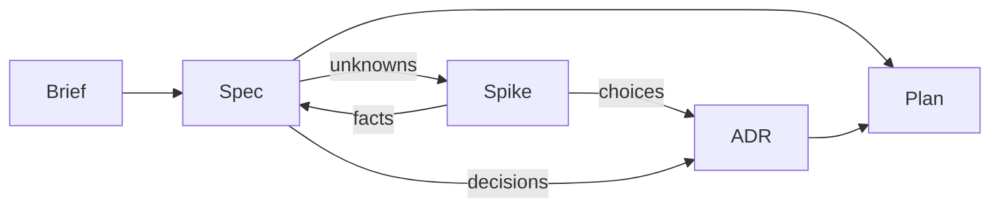
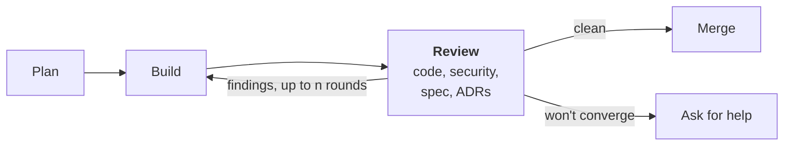

# Software Development Lifecycle (SDLC)

*In development: `/spec` is built; the other skills are still being designed.*

A software development lifecycle is the path work takes from an idea for a product to working
code. This repository defines one, and packages it as a plugin for
[Claude Code](https://code.claude.com/docs), Anthropic's coding assistant, so that Claude follows
it with you in any repository you install it in.

## How it works

The lifecycle keeps its thinking in a few kinds of document, each a Markdown file in your
repository:

- **Brief:** what the product is, who it is for and why. One per product.
- **Spec:** what one capability of the product should do, and how we will know it does. A
  product has many.
- **ADR** (architecture decision record): one technical decision and why it was made. Once
  accepted it is never edited; a later decision supersedes it with a new ADR.
- **Plan:** a piece of work that builds part of a spec or an ADR. It is deleted once built.

Each document has a status, such as Draft or Ready to build, which says how far along it is.

The plugin gives Claude three kinds of help to work with these documents:

- **Skills:** instructions Claude follows for one step, which you run as a slash command such as
  [`/spec`](docs/skills/spec.md). The plugin's skills are named `/sdlc:spec` and so on; this page leaves out the
  `sdlc:` prefix.
- **Agents:** separate Claude instances that start with no memory of your conversation and
  only the tools they need, so their work is not swayed by your conversation. A skill hands them work such as
  building a plan or reviewing a document.
- **Hooks:** small scripts Claude Code runs automatically at set moments. This plugin uses them
  to give Claude a summary of the lifecycle when a session starts, and to refuse status changes
  Claude makes that the lifecycle does not allow.

Every document a skill writes is checked by a reviewer agent before you see it. Apart from the
documents, the plugin adds nothing to your repository, unless you choose to install it for
everyone working there (see [Install](#install)).

The work runs in two stages. Planning decides what to build and how, and ends with a plan.
Building turns the plan into reviewed code on the main branch.

## Planning



### [`/brief`](docs/skills/brief.md)

Writes the brief with you. Every spec is written against it.

### [`/spec`](docs/skills/spec.md)

Writes or changes a spec with you. Research is part of writing it.

### [`/spike`](docs/skills/spike.md)

When an unknown can only be settled by trying something, we build a throwaway experiment before
the real work. A fact goes back into the spec; a choice becomes an ADR. A spike agent runs
the experiment in its own copy of the repository, so the throwaway code never touches the real
work.

### [`/adr`](docs/skills/adr.md)

Records a technical decision with you, whether it came from a spike or straight from shaping a
spec.

### [`/plan`](docs/skills/plan.md)

Scopes a piece of work against the specs and ADRs it delivers.

## Building



### [`/build`](docs/skills/build.md)

A build agent carries out the plan, then four reviewer agents check the result in parallel:

- **Code:** is it correct and well made?
- **Security:** does it open any holes?
- **Spec:** is everything the plan was for built and shown to work, with nothing unrequested
  added? Once every requirement in the spec is, the spec is marked Built.
- **ADRs:** is every accepted decision followed, not just the ones the plan touches?

Findings go back to the build agent for up to n rounds (a plugin setting, 3 by default). A clean
review merges the work into the main branch; if it won't converge, we stop and ask for help.

## Audit

### [`/audit`](docs/skills/audit.md)

Code and its documents can drift apart, for example when someone changes code without going
through this lifecycle. `/audit` runs the spec and ADR reviewers across the whole repository and
reports where they disagree; you choose whether to fix the code, reopen the spec, or supersede
the ADR.

## Principles

The rules the lifecycle follows, such as one decision per ADR, are kept in one short file,
[context/sdlc.md](context/sdlc.md). The plugin gives that file to Claude at the start of every
session, so Claude knows how the steps fit together even when you run only one of them.

## Install

In Claude Code:

```
/plugin marketplace add michaelmarconi/sdlc
/plugin install sdlc@sdlc
```

Or from a terminal:

```bash
claude plugin marketplace add michaelmarconi/sdlc
claude plugin install sdlc@sdlc
```

Add `--scope project` to the `install` command to share the plugin with everyone working in a
repository.

## Update

```bash
claude plugin marketplace update sdlc
claude plugin update sdlc@sdlc
```

To update automatically, run `/plugin`, open **Marketplaces**, select `sdlc` and choose
**Enable auto-update**. New versions load on the next session or after `/reload-plugins`.

## Skills

| Skill | What it does |
| --- | --- |
| [`/spec`](docs/skills/spec.md) | Writes or changes a spec with you, and has it reviewed before you see it |

## Contributing

Read [AGENTS.md](AGENTS.md) first. It holds the rules every skill is built to and the checks a
change must pass.
