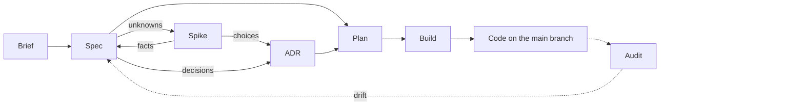

# Software Development Lifecycle (SDLC)

A software development lifecycle is the path work takes from an idea for a product to working
code. This repository defines one, and packages it as a plugin for
[Claude Code](https://code.claude.com/docs), Anthropic's coding assistant, so that Claude follows
it with you in any repository you install it in.

## Install

Tested with Claude Code on Sonnet 5.5 and Opus 5.5 (see [Models](#models)).

In Claude Code:

```
/plugin marketplace add michaelmarconi/sdlc
/plugin install sdlc@sdlc
```

Or from a terminal:

```bash
claude plugin marketplace add michaelmarconi/sdlc
claude plugin install sdlc@sdlc
```

Add `--scope project` to the `install` command to share the plugin with everyone working in a
repository.

### Update

```bash
claude plugin marketplace update sdlc
claude plugin update sdlc@sdlc
```

To update automatically, run `/plugin`, open **Marketplaces**, select `sdlc` and choose
**Enable auto-update**. New versions load on the next session or after `/reload-plugins`.

Claude Code doesn't say what a new version changed, so [CHANGELOG.md](CHANGELOG.md) does. Read
it before you update past a major version, for example from 1.x to 2.0: it says what you need to
change in your documents. Until 1.0, any minor version may need such a change, and its entry
says so.

## How it works

The lifecycle keeps its thinking in a few kinds of document, each a Markdown file in your
repository:

- **Brief:** what the product is, who it is for and why. One per product.
- **Spec:** what one capability of the product should do, and how we will know it does. A
  product has many.
- **ADR** (architecture decision record): one technical decision and why it was made.
- **Plan:** a piece of work that builds part of a spec or an ADR. It is deleted once built.

Each document except the brief has a status, such as Draft or Ready to build, which says how far
along it is.

One rule matters when you edit documents by hand: the brief, specs and ADRs never refer to each
other, whether by hyperlink, path or title, because either end can change or be deleted without
the other being touched, and the reference quietly goes stale. Only a plan, which is deleted
once built, refers to the specs and ADRs it builds, and an ADR refers to the one it replaces.

The plugin gives Claude three kinds of help to work with these documents:

- **Skills:** instructions Claude follows for one step, which you run as a slash command such as
  `/spec`. The plugin's skills are named `/sdlc:spec` and so on; this page leaves out the
  `sdlc:` prefix.
- **Agents:** separate Claude instances that start with no memory of your conversation and only
  the tools they need, so their work is not swayed by it. A skill hands them work such as building
  a plan or reviewing a document.
- **Hooks:** small scripts Claude Code runs automatically at set moments. This plugin uses them
  to give Claude the lifecycle rules when a session starts in a repository that uses it, and to
  refuse spec and ADR edits Claude makes that the lifecycle does not allow, such as an illegal
  status change. After a review, a hook also hands the correction checker the review reports and
  the document as it was reviewed, word for word, keeping them in the plugin's own data folder
  outside your repository until the check is done. Another lets the plugin's skills and agents
  read the plugin's own files, such as a rubric, without asking you each time; it approves
  reads inside the plugin's folder only. They need Python 3.

Every document a skill writes is checked by a reviewer agent before you see it, and by a
language checker that checks someone new to your project could follow its words. Apart from the
documents, the plugin adds nothing to your repository, unless you choose to install it for
everyone working there (see [Install](#install)).

[The lifecycle rules](docs/lifecycle.md) hold the whole lifecycle: every document's statuses, the
principles, and how reviews work. Claude gets that page at the start of every session in a
repository that uses the lifecycle.

## Skills

Each step of the lifecycle has a skill. In the order you would use them:



| Skill | What it does | Status |
|---|---|---|
| [`/brief`](docs/skills/brief.md) | Writes or changes the product brief with you | Built |
| [`/spec`](docs/skills/spec.md) | Writes or changes the spec for one capability | Built |
| [`/spike`](docs/skills/spike.md) | Settles an unknown with a throwaway experiment | Not built yet |
| [`/adr`](docs/skills/adr.md) | Records one technical decision | Built |
| [`/plan`](docs/skills/plan.md) | Scopes a piece of work against its specs and ADRs | Not built yet |
| [`/build`](docs/skills/build.md) | Builds a plan, has it reviewed and merges it | Not built yet |
| [`/audit`](docs/skills/audit.md) | Finds where the code and its documents have drifted apart | Not built yet |
| [`/issue`](docs/skills/issue.md) | Reports a problem with this plugin, so its fix is tested | Built |

## Models

Claude Code can run on different Claude models, and a skill that works well on one may behave
differently on another. The plugin handles this in three ways.

- **Skills use your model.** A skill (such as `/spec`) runs on whichever model your Claude Code
  session uses, so you choose it, with `/model`, as you normally would.
- **Reviewers use a fixed model.** Each skill hands its work to a reviewer, a separate Claude
  that checks the document against a list of rules and reports what fails. Reviewers always run
  on Sonnet, so the same document gets the same judgement whatever model your session uses. To
  override it, set the environment variable `CLAUDE_CODE_SUBAGENT_MODEL` to a model name together
  with `CLAUDE_CODE_SUBAGENT_MODEL_FORCE=1` (Claude Code 2.1.257 or later); note that this
  changes every subagent, not just the reviewers. Results on other models are untested.
- **Every change is tested on each supported model.** Each skill has evals: scripted
  conversations whose results are checked automatically, some by simple text matching and some by
  a second Claude acting as judge, always Sonnet. A change is released only if its evals pass
  on Sonnet 5.5 and on Opus 5.5, the models listed under [Install](#install). When a new model
  comes out, the evals are run on it before it is added to that list.

## Contributing

Read [AGENTS.md](AGENTS.md) first. It holds the rules every skill is built to and the checks a
change must pass. The plugin's own design decisions, and why they were made, are recorded as
architecture decision records in [docs/adrs/](docs/adrs/).
