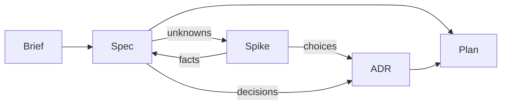
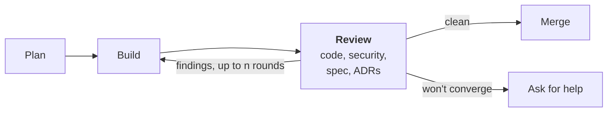

# Software Development Lifecycle (SDLC)

*In development: `/brief`, `/spec`, `/adr` and `/issue` are built; the other skills are still being designed.*

A software development lifecycle is the path work takes from an idea for a product to working
code. This repository defines one, and packages it as a plugin for
[Claude Code](https://code.claude.com/docs), Anthropic's coding assistant, so that Claude follows
it with you in any repository you install it in.

## How it works

The lifecycle keeps its thinking in a few kinds of document, each a Markdown file in your
repository:

- **Brief:** what the product is, who it is for and why. One per product, holding only what is
  true of the whole product.
- **Spec:** what one capability of the product should do, and how we will know it does. A
  product has many.
- **ADR** (architecture decision record): one technical decision and why it was made. Once
  accepted it is never edited; a later decision supersedes it with a new ADR.
- **Plan:** a piece of work that builds part of a spec or an ADR. It is deleted once built.

Each document except the brief has a status, such as Draft or Ready to build, which says how far
along it is. The brief has none, because it is never built, only kept true.

The plugin gives Claude three kinds of help to work with these documents:

- **Skills:** instructions Claude follows for one step, which you run as a slash command such as
  [`/spec`](docs/skills/spec.md). The plugin's skills are named `/sdlc:spec` and so on; this page leaves out the
  `sdlc:` prefix.
- **Agents:** separate Claude instances that start with no memory of your conversation and
  only the tools they need, so their work is not swayed by your conversation. A skill hands them work such as
  building a plan or reviewing a document.
- **Hooks:** small scripts Claude Code runs automatically at set moments. This plugin uses them
  to give Claude a summary of the lifecycle when a session starts in a repository that uses it,
  to remind you at the start of every session if a plugin setting is not saved yet (see
  [Install](#install)), and to refuse spec and ADR edits Claude makes that the lifecycle does not allow, such as an illegal
  status change. They need Python 3.

Every document a skill writes is checked by a reviewer agent before you see it. Apart from the
documents, the plugin adds nothing to your repository, unless you choose to install it for
everyone working there (see [Install](#install)).

The work runs in two stages. Planning decides what to build and how, and ends with a plan.
Building turns the plan into reviewed code on the main branch.

## Planning



### [`/brief`](docs/skills/brief.md)

Writes or changes the brief with you, from what you say and the documents you point it to. Every
spec is written against it.

### [`/spec`](docs/skills/spec.md)

Writes or changes a spec with you. Research is part of writing it.

### [`/spike`](docs/skills/spike.md)

When an unknown can only be settled by trying something, we build a throwaway experiment before
the real work. A fact goes back into the spec; a choice becomes an ADR. A spike agent runs
the experiment in its own copy of the repository, so the throwaway code never touches the real
work.

### [`/adr`](docs/skills/adr.md)

Records a technical decision with you, whether it came from a spike or straight from shaping a
spec: one decision per ADR, with the options it beat. Only you can accept or reject it.

### [`/plan`](docs/skills/plan.md)

Scopes a piece of work against the specs and ADRs it delivers.

## Building



### [`/build`](docs/skills/build.md)

A build agent carries out the plan, then four reviewer agents check the result in parallel:

- **Code:** is it correct and well made?
- **Security:** does it open any holes?
- **Spec:** is everything the plan was for built and shown to work, with nothing unrequested
  added? Once every requirement in the spec is, the spec is marked Built.
- **ADRs:** is every accepted decision followed, not just the ones the plan touches?

Findings go back to the build agent for up to n reviews in all (the Review rounds setting,
see [Install](#install)). A clean review merges the work into the main branch; if it won't converge, we stop and ask for help.

## Audit

### [`/audit`](docs/skills/audit.md)

Code and its documents can drift apart, for example when someone changes code without going
through this lifecycle. `/audit` runs the spec and ADR reviewers across the whole repository and
reports where they disagree; you choose whether to fix the code, reopen the spec, or supersede
the ADR.

## Feedback

### [`/issue`](docs/skills/issue.md)

When a skill gets something wrong, or the lifecycle gets in your way, `/issue` turns it into an
issue on this plugin's GitHub repository. It asks what happened and what you expected, gathers
the versions involved, and leaves out anything that would identify your project. You see the
draft before anything is filed. Each issue becomes a test the plugin must pass before the fix
is released, so the same problem can't quietly come back.

## Principles

The rules the lifecycle follows, such as one decision per ADR, are kept in one short file,
[context/sdlc.md](context/sdlc.md). The plugin gives that file to Claude at the start of every
session in a repository that has a brief or a spec, so Claude knows how the
steps fit together even when you run only one of them.

One rule matters when you edit documents by hand: the brief, specs and ADRs never refer to each
other, whether by hyperlink, path or title, because either end can change or be deleted without
the other being touched, and the reference quietly goes stale. Only a plan, which is deleted
once built, refers to the specs and ADRs it builds, and an ADR refers to the one it replaces.

## Install

Tested with Claude Code on Sonnet 5.5 and Opus 5.5 (see [Models](#models)).

In Claude Code:

```
/plugin marketplace add michaelmarconi/sdlc
/plugin install sdlc@sdlc
```

Or from a terminal:

```bash
claude plugin marketplace add michaelmarconi/sdlc
claude plugin install sdlc@sdlc
```

Add `--scope project` to the `install` command to share the plugin with everyone working in a
repository.

Then save the plugin's settings. Claude Code does not fill them in for you, so until they are
saved, skills that need them stop and ask, and every session starts with a reminder. The install
shows a configure screen whose boxes start empty: pressing Enter there saves nothing, and Claude
Code still reports the plugin as active. In Claude Code, run `/plugin configure sdlc@sdlc`, type
a value next to each setting, choose **Save configuration**, then run `/reload-plugins`; from a terminal, add `--config <key>=<value>` to the `install` command. Each
setting's description says what it does and suggests a value. Settings are saved in your own
Claude Code settings, not in the repository, so you save them once per computer. If you added
the marketplace under another name, use `sdlc@<that name>` in place of `sdlc@sdlc`. Claude Code's
`/config` may list a setting with its suggested value before you have saved it; skills receive
only a value you saved.

| Setting | Key | What it does |
| --- | --- | --- |
| Review rounds | `review_rounds` | How many reviews a skill or `/build` may run on one piece of work, counting the first, before it stops and asks you |

## Models

Claude Code can run on different Claude models, and a skill that works well on one may behave
differently on another. The plugin handles this in three ways.

- **Skills use your model.** A skill (such as `/spec`) runs on whichever model your Claude Code
  session uses, so you choose it, with `/model`, as you normally would.
- **Reviewers use a fixed model.** Each skill hands its work to a reviewer, a separate Claude
  that checks the document against a list of rules and reports what fails. Reviewers always run
  on Sonnet, so the same document gets the same judgement whatever model your session uses. To
  override it, set the environment variable `CLAUDE_CODE_SUBAGENT_MODEL` to a model name together
  with `CLAUDE_CODE_SUBAGENT_MODEL_FORCE=1` (Claude Code 2.1.257 or later); note that this
  changes every subagent, not just the reviewers. Results on other models are untested.
- **Every change is tested on each supported model.** Each skill has evals: scripted
  conversations whose results are checked automatically, some by simple text matching and some by
  a second Claude acting as judge, always Sonnet. A change is released only if its evals pass
  on Sonnet 5.5 and on Opus 5.5, the models listed under [Install](#install). When a new model
  comes out, the evals are run on it before it is added to that list.

## Update

```bash
claude plugin marketplace update sdlc
claude plugin update sdlc@sdlc
```

To update automatically, run `/plugin`, open **Marketplaces**, select `sdlc` and choose
**Enable auto-update**. New versions load on the next session or after `/reload-plugins`.

Claude Code doesn't say what a new version changed, so [CHANGELOG.md](CHANGELOG.md) does. Read
it before you update past a major version, for example from 1.x to 2.0: it says what you need to
change in your documents. Until 1.0, any minor version may need such a change, and its entry
says so.

## Skills

| Skill | What it does |
| --- | --- |
| [`/brief`](docs/skills/brief.md) | Writes or changes the product brief with you, and has it reviewed before you see it |
| [`/spec`](docs/skills/spec.md) | Writes or changes a spec with you, and has it reviewed before you see it |
| [`/issue`](docs/skills/issue.md) | Reports a bug or suggests an improvement in this plugin, with your project's details left out |

## Contributing

Read [AGENTS.md](AGENTS.md) first. It holds the rules every skill is built to and the checks a
change must pass.
