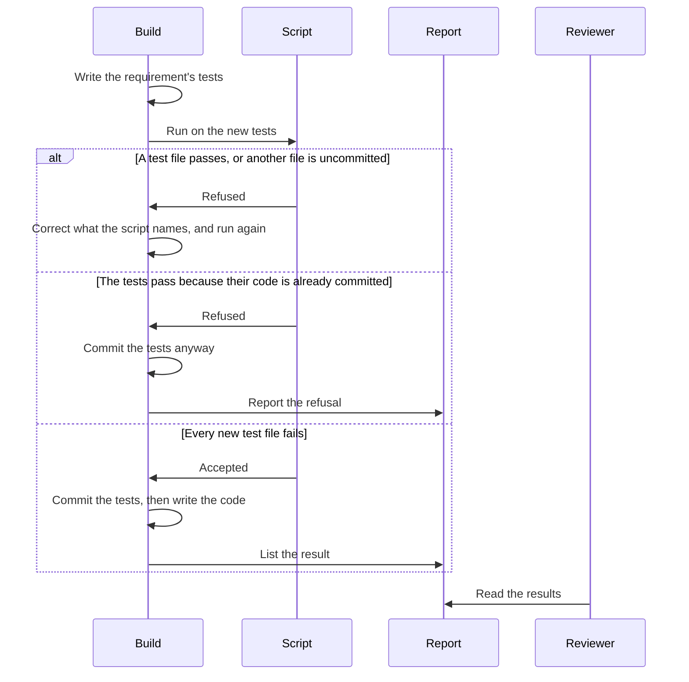

---
# Change status only through the agentic plugin's skills, which check each change; a change made by hand is not checked.
type: ADR
status: 👍 Accepted
date: 2026-11-16
---

# Check that each requirement's tests fail without its code before committing them

## Question

How does the plugin make sure a build[^build] writes each requirement's[^requirement] tests, and
sees them fail, before it writes that requirement's code?

## Decision

Chosen: before writing a requirement's code, the build names its new or changed test files to a
script, which runs each with the project's test command. The script refuses if any file passes.
It also refuses if other files are uncommitted. Once it accepts, the build commits the tests and
reports the result. If the tests pass because their code is already committed, the build commits them
anyway and reports the refusal. A script now refuses when code comes before its tests; before, a reviewer[^reviewer] had
to notice it.

## Background

The plugin's build step tells Claude to see each requirement's tests fail before writing its code.
In one build, Claude wrote two of twelve requirements' code first. The reviewer judged the
same commit order differently in two review rounds. Claude's mistake was found after the push,
when fixing it meant rewriting commits.

## Options

| Option | Outcome | Why |
| --- | --- | --- |
| Check each requirement's tests fail before its code | Chosen | A script refuses code written before its tests, with no extra agent |
| Run new tests on the code from before the build, once at the end | Rejected | Tests of code in new files always fail there, proving nothing |
| A separate agent writes every test, and the build writes the code | Rejected | A second agent, at 1.6 times the cost of the current build step |
| Three agents: one writes tests, one code, one hands work between them | Rejected | 3 times the cost and time of the current build step |
| Label commits by requirement, then check their order | Rejected | Adds labels to the person's commit messages |
| Only reword the instructions and the reviewer's check that tests came first | Rejected | Already clear, yet not followed |

## Consequences

- Good: a script refuses tests that already pass, or uncommitted code written before its tests.
- Good: the reviewer reads recorded results instead of judging the commit order.
- Bad: one more test run per requirement.
- Bad: a test file that cannot load also fails, so the build must read why, or may accept a broken test and correct it after the code.

## Out of scope

- Whether the tests check what the examples in the spec[^spec] say: the reviewer's check against those examples covers that.
- Judging tests one by one: the script judges whole files.
- Repeating the build's instructions to Claude during a long build: left to another decision.

## How we'll check

Applies to: any build step that commits a requirement's tests.

1. Test: unit tests run the script where a named file fails, passes or is unchanged, or other files are uncommitted.
2. Inspection: the build runs the script before committing each requirement's tests, reads each failure's cause, and lists every result in its report.
3. Inspection: the reviewer judges whether tests came first from those results, not the commit order.

## Open questions

None.

## Technical detail

**The script.** `skills/build/scripts/before_code.py --command "<command with {file}>" FILE...`,
run from the repository. It lists the uncommitted paths and refuses, exit 1, when a named file is
not new or changed, when anything other than the named files is uncommitted ("code must wait until
its tests are committed"), or when any named file's command exits 0 ("its tests already pass, so
they cannot show the code works"). Otherwise it prints "Accepted: every new test file fails." and exits
0. Exit 2 is a usage error, or a folder outside a git work tree. It prints the last lines of each
file's output. A changed file keeps its older tests, which pass, so it fails only when a test the
build added fails.

**The build.** For each requirement, the build writes its tests, runs the script with the command
that runs one test file, taken from the test command the project has written down, or worked out from the repository, as
the build already does. It reads each failure, which must come from the missing behaviour, not from
a file that cannot load. On exit 0 it commits the tests, then writes the code. On exit 1 it corrects
what the script names and runs it again, unless the tests pass because their code is already
committed: then it commits them and reports the refusal. The "Tests and lint" section of the build's
report file gives each requirement's result.

**The reviewer.** The check that tests were written before code passes when the report gives, for
each requirement with tests, the script's accepted result, or a refusal whose reason the reviewer finds
sound.

**Evidence.** A trial on a small project of eight requirements, with code for two committed before
their tests by an earlier stopped build. With this option, the script ran for every requirement,
always before its code, and refused those two requirements' tests. The trial's build was not yet told to read each failure's cause: one test file had a
syntax error, so it failed and was accepted, and the build corrected it after writing the code and
reported it. That is why the build now reads each failure. On the same project, a separate test-writer agent cost 1.6 times as much as the
current build step, and three agents 3 times the cost and time.

[^build]: A build is the plugin's step that writes the code for one plan (a document scoping a piece of work), tests first, on a branch of its own, and has it reviewed by separate Claude agents.
[^requirement]: A requirement is one numbered rule in a spec, with examples a test can check.
[^reviewer]: The reviewer is the separate Claude agent that checks a build against its plan before it is handed over.
[^spec]: A spec is the plugin's document saying what one capability of the product should do.
