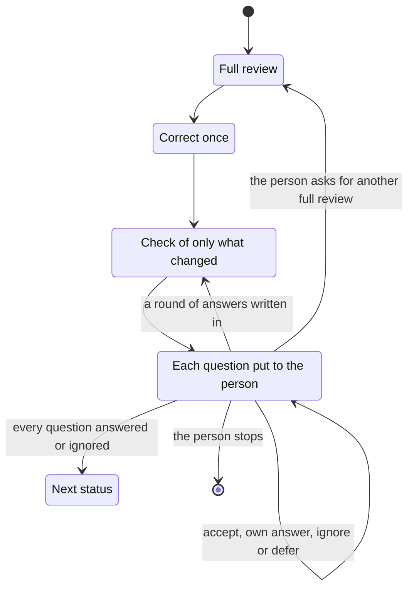

---
# Change status only through the agentic plugin's skills, which check each change; a change made by hand is not checked.
type: ADR
number: 0049
status: Accepted 👍
date: 2026-11-18
supersedes: 0010
---

# Review a document once, then check only what changes, with the person deciding each question

## Question

After a document's first review, how are the person's answers checked, so the person decides when it
ends?

## Decision

Chosen: one full review[^review], then a check[^check] of only what changed after each round of
correcting or answering:

- Each question, and each fault[^fault] the writer cannot fix, is put to the person once: accept,
  own answer, ignore or defer. Only deferred ones are written into Open questions[^question].
- A check raises what a change leaves uncovered as a question, never a failure. It is skipped when
  nothing was written in.
- Once every question is answered or ignored, the last question offers the document's next
  status[^status], another full review, or stopping; while any is deferred, only the last two. A
  document may move on with a fault ignored.
- A full review runs again only:
  - on a document rewritten to a new layout;
  - in a new conversation;
  - after the person's own change;
  - when they ask.

Since any question can be ignored, the person ends the loop.

## Background

[ADR 0010](0010-correction-check.md) has each document reviewed, corrected and checked once, but
any later change runs it all again. Answers to open questions are
such a change. So each round of answers brings a full review, which always finds new questions,
while the next status needs Open questions empty. A spec[^spec] was reviewed 11 times.

## Options

| Option | Outcome | Why |
| --- | --- | --- |
| Review again after each round of answers, as now | Rejected | Raises new questions that can't be set aside |
| Write answers in without a check | Rejected | Answers, usually new rules, go unread |
| Keep full reviews, but let the person set questions aside | Rejected | Each round costs a full review |
| Cap the number of reviews | Rejected | Any cap is arbitrary, and counting adds state |
| Review once, then check what changed, with four choices per question | Chosen | Rounds cost a check, and the person ends them |

## Consequences

- Good: the person decides when the review ends.
- Bad: an older problem the first review missed stays, unless the person asks again.
- Bad: an ignored question leaves no record, so a later review may raise it again.
- Bad: ignoring a fault leaves the document failing that rubric[^rubric] check.

## Out of scope

- Building code: [ADR 0038](0038-accept-open-findings.md).
- What reviewers ask about: that is each skill's[^skill] rubric.

## How we'll check

Applies to: every skill that reviews a document before sign-off.

1. Test: answers start a check, not a full review.
2. Test: a check reports what a change leaves uncovered as a question, never a failure.
3. Test: only deferred questions reach Open questions.
4. Test: a full review runs only where Decision's last point says.
5. Test: checks can follow checks.

## Open questions

None.

## Technical detail

**The sequence.** A full review is two separate Claudes working at the same time: a reviewer that
checks the document against the skill's rubric, and a language checker that checks the wording.
The Claude that wrote the document corrects it once. The correction
checker, a Claude that checks only the corrections, then checks. The correct step no longer files
the review's questions as open questions: they are put to the person as below. After that, each
round of questions ends with one check if an answer was written in. A check judges only the changed
text, but reads the whole document, the other documents of its kind and the document that says what
the whole product is for. It asks whether each answer was written in as the person gave it, whether
each changed sentence passes the rubric and keeps every term a newcomer would not know footnoted or
in plain words, and whether it contradicts anything. A situation the change does not cover goes
under a new Questions section of its report. When nothing is left, the last question offers the
skill's next status, such as `Accepted 👍`, one more full review, or stopping.

**The four choices.** Each question is laid out as [ADR 0030](0030-open-questions-layout.md) says,
then asked on Claude Code's question tool with the options "Accept", "My own answer", "Ignore" and
"Defer". Accept and My own answer write the answer into the document. Ignore writes nothing. Defer
writes the question into Open questions with its proposal, where it blocks the next status as open
questions do now. A fault the writing Claude cannot fix is asked the same way; Ignore then leaves
the document as it is, and the agent says which check it fails. Where there is no question tool,
the message ends "Accept, give your own answer, ignore or defer?".

**What the check is given.** The document as last checked and the person's answers, as
[ADR 0050](0050-checker-hook-answers.md) decides.

[^review]: A full review is a separate Claude, with none of the conversation, reading the whole document for what is wrong or missing.
[^check]: A check is a separate Claude judging only what changed, against the rest of the document, by a fixed list of yes-or-no questions.
[^question]: An open question is something in a document only the person can settle, with a proposed answer.
[^status]: A status is the field at the top of a document that says how far along it is, such as Draft or Accepted.
[^spec]: A spec is the plugin's document that says what one capability of a product should do.
[^fault]: A fault is something a review or check found that breaks one of the document's rubric checks.
[^skill]: A skill is a set of instructions Claude follows for one step of the plugin, run as a command.
[^rubric]: A rubric is a skill's short list of pass-or-fail checks for its documents.
