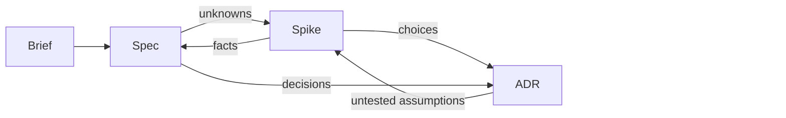
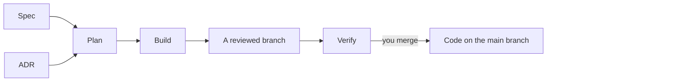
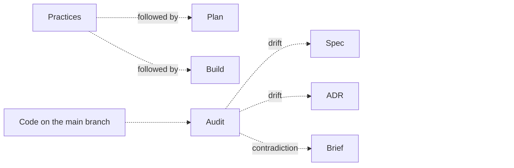
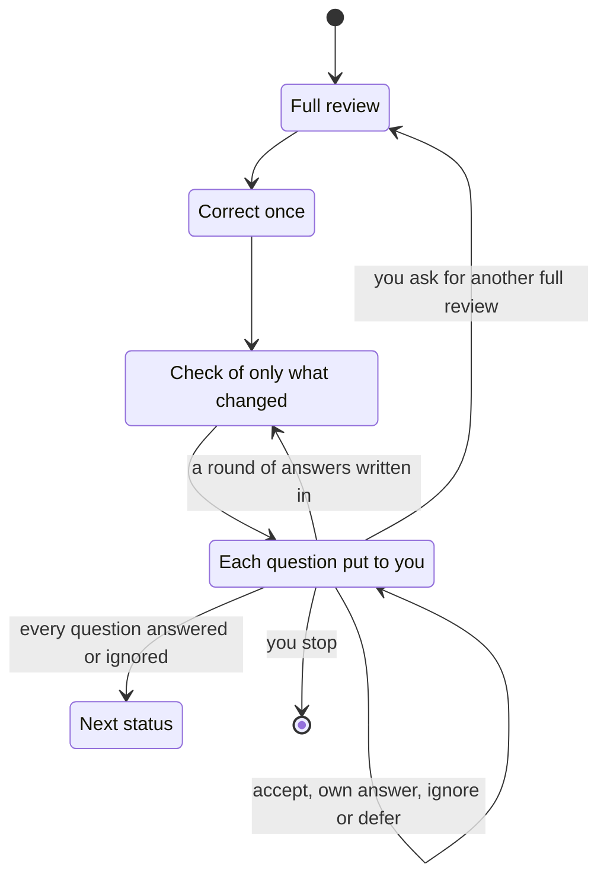

# The lifecycle rules

This page holds the whole lifecycle: the documents it keeps, the steps that write them, the
principles they follow, the words they use and how every document is reviewed. The plugin gives this page to Claude
at the start of every session in a repository that has a brief or a spec, so Claude knows how the
steps fit together even when you run only one of them. The [README](../README.md) introduces the
plugin and how to install it.

## Documents

The lifecycle keeps its thinking in five kinds of document, each a Markdown file in your
repository. Each says what kind of document it is in the `type:` field of its frontmatter, the
block of settings at the top of the file: `Brief`, `Spec`, `ADR`, `Plan` or `Spike`, so its title
never needs to. Every document except the brief also has a status, the `status:` field, which says
how far along it is, written as its word then an emoji, such as `Accepted 👍`; documents
written by earlier versions of the plugin, with the emoji in front, still count, and are rewritten
the next time a skill edits them. Beside it, the `date:` field gives the day that status was set, written
YYYY-MM-DD; a plugin hook refuses a status change that does not set it to that day.

Each file is named by one rule: a number or a date, where its kind has one, then two to five
lowercase words joined by hyphens, each a word of the document's title, so you know the file when
you open it. A plugin hook refuses a new document whose name breaks the rule, and an edit that
drops one of those words from the title, so a name never has to change, least of all while its
review runs.

- **Brief**, `docs/brief.md`: what the product is, who it is for and why. One per product,
  holding only what is true of the whole product. No status, since it is never built: it states
  the product's intent, is edited in place, and changes only when you change that intent.
- **Spec**, `docs/specs/**/<subject>.spec.md`: what one capability of the product should do,
  and how we will know it does. A product has many. Statuses: `Draft 📝` → `Accepted 👍`; any change returns it
  to `Draft 📝`. The status describes the document, not the software: whether the software meets
  a spec is found by checking the software against it.
- **ADR** (architecture decision record), `docs/adrs/NNNN-<subject>.md`, in one flat folder: one
  technical decision and why it was made. It reads from plain to technical: a part for people,
  of at most 500 words, from the question to the open questions, leaving out any diagram of the
  chosen option, then the technical detail for agents and reviewers. Its `number:` field repeats
  the four digits its name starts with, so a reader sees the number other ADRs use; a plugin hook
  refuses one that does not match. Statuses: `Draft 📝` → `Accepted 👍` or `Rejected ❌`;
  `Accepted 👍` → `Superseded ↪️`.
- **Plan**, `docs/plans/YYYY-MM-DD-<subject>.md`, in one flat folder: a piece of work that builds
  part of a spec or an ADR. Statuses: `Draft 📝` → `Ready to build 🟢` → `Built ✅`; any change
  returns it to `Draft 📝`. A plan is temporary: once `Built ✅` it is frozen, never
  changed again, and may be deleted whenever nobody needs it.
- **Spike record**, `docs/spikes/YYYY-MM-DD-<subject>.md`, in one flat folder: one hypothesis
  tested by a throwaway experiment, with the finding, the experiment's code and what each run
  produced. It reads from plain to technical: a part for people, of at most 600 words for the design
  and 400 for the verdict written after the runs, then the experiment's detail for agents and
  reviewers. Statuses: `Draft 📝` → `Ready to run 🟢` → `Confirmed 💡`, `Refuted 🚫` or `Not settled ❔`;
  `Ready to run 🟢` → `Draft 📝` only before the first run. Once `Ready to run 🟢`, its design is
  fixed, and only the run script adds runs. A finished spike record is never changed again, and may
  be deleted whenever nobody needs it.

A repository is one product, so every `docs/` path on this page is counted from the top of the git
repository, wherever in it the session started, or from the session's folder in a project without
git. A monorepo, several related apps or packages in one
repository, keeps one `docs/` folder at its top; its specs may be grouped into folders, such as one
per app, which carry no meaning.

Every document has an Open questions section, holding what only you can settle, or "None." when
nothing is open. Each open question is laid out the same way, so you can find the proposal at a
glance: a numbered heading saying what is to be settled, the context it needs, then a quote holding
the proposed answer and the reason for it. A question with two answers is two questions. A plugin
hook refuses Open questions laid out any other way. A document written before this layout keeps
it until its Open questions next change.

```markdown
### 1. Where the daily tariff copy is kept

The tariff is copied every day, but where it is kept is not yet chosen.

> **Proposed:** Object storage, one file per day.
>
> **Why:** The copy is read whole once a day and never searched.
```

When a skill asks you to settle a question during the session, it uses the same parts: a bold line
naming the question and its place in the count, such as "**Question 2 of 7: where the tariff copy is
kept**", then the context, the quote, and the question itself last. The first number counts the
questions asked or settled in the session, across every document, the one being asked included, so it only goes up; the
total adds those still open, and the skill says in one line when an answer opens or settles others.
Where Claude has no question tool but can post a decision card, as in a Claude project thread, it
asks in words as above, then posts the same question on a card you answer with a tap. When one reply
asks several questions, each is followed straight away by its own card, or the question tool, and a
horizontal rule comes before the next, so you always know which card answers which question.

## Steps

Each step has a skill: instructions Claude follows for that step, which you run as a slash
command. The plugin's skills are named `/agentic:<name>`, such as `/agentic:spec`; this page leaves out
the `agentic:` prefix.

- `/brief` writes or changes the brief.
- `/spec` writes or changes the spec for one capability.
- `/spike` settles an unknown by a throwaway experiment, when one is needed, and writes it up as a
  spike record. A fact goes back into the spec; a choice becomes an ADR. `/spike` edits neither:
  you take the finding to `/spec` or `/adr`.
- `/adr` records one technical decision.
- `/plan` scopes a piece of work against the specs and ADRs it delivers.
- `/build` builds a plan on a branch of its own, has it reviewed, and pushes the branch to your
  remote. It never starts the product, so it can run on any machine.
  Opening a pull request and merging stay with you.
- `/verify` checks the running product against accepted specs from the outside, usually after
  `/build` and before you merge: agents that never read the code start the product, try each
  example of the requirements you agree, and give each a verdict with evidence. It changes
  nothing: you decide what follows.
- `/release` makes a release once enough work is merged: a version number, release notes for the
  product's users and the one commit they describe, by the steps the releasing practice records.
  It drafts the notes from the `Release-note:` line each build leaves in its last commit, has them
  reviewed and asks you to sign them off. It publishes only where the practice records a publish
  command, and only on your yes. It never merges.
- `/deploy` puts one release into one environment, such as staging or production, by the steps the
  deploying practice records: it shows what will go where, deploys only on your yes, runs the
  recorded check and, if the check fails, rolls back at once. It writes nothing to the repository.
- `/audit` finds drift, where the code and its documents disagree, and any spec or ADR that
  contradicts the brief, at any time. It changes nothing: you choose each correction.
- `/practices` records how the project does things, such as the commands that check the work and
  the rules an agent follows, one topic at a time. It is not a step in the sequence: run it
  whenever you need it. Practices are not a lifecycle document and have no status: their essentials
  live in `AGENTS.md`, which Claude Code loads, and longer topics in `docs/practices/`. They are
  written for agents, so every skill sees them, and `/plan` and `/build` follow them.
- `/feedback` drafts a GitHub issue about the plugin itself, when one of its skills gets something
  wrong or could work better. It is not a step in the sequence either, and writes nothing in your
  repository.

The steps fall into two phases, and the other skills belong to neither.

### Deciding what to build



### Building it



### Any time



## Principles

- **The brief is the whole product.** It holds only what is true of the whole product; one
  capability's behaviour belongs in its spec.
- **The brief changes only when its intent does.** Specs and ADRs add detail the brief never
  mentions, and that is never a reason to change it, so no skill or agent proposes an edit to the
  brief to match one. Only an outright contradiction counts: a spec or ADR that breaks the brief's
  Goals, Out of scope or Constraints, such as a spec for something the brief puts out of scope. You
  settle it one of two ways: change the spec, or supersede the ADR, to fit the brief; or change the
  brief. Either answer removes the contradiction, so it is never raised again. `/spec` raises one
  while the spec is written, as an open question in the spec; `/audit` finds any that appear later,
  such as after the brief changes.
- **Specs say what, never how.** A spec says what the system does. A technical choice is an ADR.
- **One living spec per capability.** It is edited in place, and git is its history. A retired
  spec is deleted.
- **One decision per ADR.** A decided ADR is never edited or moved. A new ADR supersedes it whole,
  each naming the other by number in its `supersedes:` and `superseded-by:` fields.
- **Only a person decides an ADR.** A person accepts or rejects it by explicitly signing off its
  final, reviewed text. No skill or agent does it for them.
- **References never go stale.** Documents refer to one another only where neither end can go stale:
  a plan to the specs and ADRs it builds, since a `Built ✅` plan is a record of how they stood when
  it was built; a spike record to the spec or ADR waiting on its hypothesis, since a finished spike
  record is a record of how that document stood; and an ADR to other ADRs, by number linked to the
  other ADR's file, since a decided ADR is never edited or moved. Nothing refers to a plan or a
  spike record. Otherwise the brief, specs and ADRs never refer to one another in any way, whether
  by hyperlink, path or title, because either end can change or be deleted without the other being
  touched, and the reference would quietly go stale. A spec or ADR that
  uses a spike's finding states its evidence in its own words.
- **Documents stand on their own.** Every lifecycle document refers to outside material only
  by a web link. Material they were drafted from, such as a requirements document, notes or a
  ticket, is stated in their own words, never referred to by hyperlink, path or title, when it was
  handed over in a conversation, lives outside the repository or sits under `docs/` beside the
  lifecycle's documents: it can change or vanish without them being touched, and `docs/` holds only
  the lifecycle's documents. A plugin hook also refuses such a hyperlink or path in any of them.
- **No separate design document.** `Accepted 👍` ADRs and the code are the design.
- **Every document but the brief carries its own status.** A plan holds nothing later work needs: a
  decision later work must follow is an ADR, one a user or caller relies on belongs in the spec,
  and one every piece of work follows is a practice. A reason someone changing the code later
  needs is left as a comment beside the code.
- **Every practice step is one command.** A step the practices record, such as running the tests
  or releasing, is one line that a skill runs as written, filling in any `{name}`, and judges by
  its exit code. It calls a runner entry, a script or a tool's standard command with nothing else
  of the project's own; anything more is a script in the project's scripts folder, written only by
  `/practices` or a build.
- **No document moves forward with open questions.** Anything only a person can settle is
  written into the document's Open questions, not left in the conversation. A spec or an ADR becomes
  `Accepted 👍`, a plan `Ready to build 🟢`, and a spike record `Ready to run 🟢`, `Confirmed 💡`,
  `Refuted 🚫` or `Not settled ❔` only when that section is empty.
- **Only legal status moves.** Only the moves listed under [Documents](#documents) are allowed,
  and only `/build` sets a plan `Built ✅`. A plugin hook refuses illegal spec, ADR, plan and spike
  record status changes, edits to decided ADRs and finished spike records, and edits to a spike
  record's fixed parts and runs, made with Claude's file-editing tools.
- **Only an experiment settles a spike.** Documentation, other people's reports and reasoning help
  design an experiment, but a spike's finding rests only on what its runs produced, compared with
  the result agreed before the first run.
- **A plan builds only on settled documents.** A plan is `Ready to build 🟢` only when each spec
  and each ADR it touches is `Accepted 👍`. No two
  plans that are not `Built ✅` name the same requirement.
  `/build` builds a plan that isn't signed off only when the person chooses to, building its open
  questions' proposed answers, and the build's first commit says what wasn't signed off.
- **Drift is a finding, not a status.** `/audit` reports it with a suggested correction: correct
  the code, return the spec to `Draft 📝`, or supersede the ADR.

## Plain words

Every document the plugin writes, including an issue it files, is for a reader who is new to the
project: someone with a computer science degree but no knowledge of the product's field or of
the conversations behind the document. So each one follows this rule:

- **Computing terms**, such as "cache", "idempotent" or "HTTP", are used freely, and so are the
  product's own name and job titles that say what the person does, such as "accounts clerk".
- **Domain terms**, words from the product's own field such as a trade, legal or business term,
  get a Markdown footnote (`[^1]`) defining them where they first appear, unless that sentence
  already explains them. A domain term that is an acronym, such as "OTIF" for "on time, in full",
  gives its full form in the footnote. A title cannot hold a footnote, so a domain term in a title
  is defined at its first use in the text. Each document defines its own terms, so it never
  depends on a glossary elsewhere that could fall out of date.
- **Anything else a newcomer would not know** is rewritten in plain words or spelled out, never
  footnoted: a name used only inside the code or the team, an acronym that is neither a computing
  term nor a domain term, or a phrase whose meaning the reader would have to guess. Read every
  phrase literally, title included: a figure of speech, an idiom, a nickname for a situation or a
  word used in a special sense of the team's own fails even when a reader could guess it, and is
  replaced by the plain statement it stands for. For example, "the order hitchhikes on the nightly
  export" becomes "the order is included in the nightly export".

An issue the plugin files is read by the plugin's maintainers, who know the lifecycle; a plan by
the people building it, who use the lifecycle; a spike record by whoever takes its finding to a
spec or an ADR, as its Next steps asks; and practices, in the Practices section of `AGENTS.md` and
in `docs/practices/`, by agents that follow the lifecycle. So in an issue, a plan, a spike record
or practices, the lifecycle's own terms, such as "spec", "ADR", "requirement", `Ready to build 🟢`
and the plugin's commands such as `/agentic:build`, count as plain too, and so do the marks
`/practices` ends a practice with, "(default)" and "(not set up yet)".

The rule covers only what the plugin writes. Your own documents, code and messages follow your
project's rules.

## Review process

No agent checks its own work. The agent that writes a document can miss its own
mistakes, so every document a skill writes is checked by a reviewer agent before a person sees
it. The reviewer is a separate Claude that starts fresh, without the conversation, so it judges
the page as a newcomer would. It checks the document against the skill's rubric: a short list of
pass-or-fail checks, such as "each requirement has exactly one rule". The same rubric guides the
skill while it writes. Beside it, at the same time, the language checker, shared by every skill
that writes a document, reads the document for words a newcomer could not follow, by the
[Plain words](#plain-words) rule.

Every document is reviewed once, then only what changes is checked, and you decide each
question:



| Step | Who does it | What it does | What comes out |
|---|---|---|---|
| **Draft** | The drafting agent: Claude running the skill, with you | Writes the document from your conversation | The document |
| **Review** | The skill's reviewer, such as `agents/spec-reviewer.md` | Checks the whole document against the skill's rubric | The review report: pass or fail for each check, quoting the check and the words that break it |
| | `agents/language-checker.md`, shared by every skill that writes a document, at the same time | Checks every phrase of the document against the [Plain words](#plain-words) rule | The wording report: pass or fail, quoting each phrase that breaks the rule |
| **Correct** | The drafting agent | Makes each correction from both reports once; a decision only you can make becomes a question for you, never a guess | The corrected document |
| **Check** | `agents/correction-checker.md`, shared by every skill that writes a document | Checks only what changed: that each correction was made, that each answer was written in as you gave it, and that no change broke anything; a situation a change leaves uncovered comes back as a question, never a failure | The check's report: pass or fail, and any questions |
| **Questions** | You, with the drafting agent | Each question, one at a time, with four choices: Accept the proposal, give your own answer, Ignore it or Defer it | The answers, written in; deferred questions in Open questions |
| **Sign-off** | You | Read the document, shown in your Claude app's file viewer where there is one and always named by its path, and the reports, and pick the next status on the last question | The document at its next status |

Accept and your own answer write the answer into the document. Ignore writes nothing, and a fault
you ignore stays, with the skill saying which check it fails. Defer writes the question into Open
questions with its proposal, where it holds the document back from its next status. Nothing else is
written there. After each round of answers, if anything was written in, the check runs again on
only what changed; it never runs a full review. Once nothing is left to ask, the last question
offers the document's next status, one more full review, or stopping; while anything is deferred,
only the last two.

If both reports pass with nothing left for you to decide, the skill hands the document to you
with no correction step. A full review runs again only when you ask, after a change you make
yourself, on a document rewritten to a new layout, or in a new conversation, since the record of
the last check is kept only within one conversation.

| Term | Meaning |
|---|---|
| **Rubric** | A skill's short list of pass-or-fail checks. The skill follows it while drafting; the reviewer checks against it. |
| **Review** | The skill's reviewer and the language checker, run side by side on the whole document. |
| **Check** | A separate Claude judging only what changed since the review or the last check, against the rest of the document. |
| **Finding** | Anything a review or check reports. It is one of the three kinds below. |
| **Failure** | A finding that breaks a rubric check. The drafting agent corrects it, or, when it can't, asks you. |
| **Question** | A finding only you can settle, such as which of two readings you meant. It is put to you, and reaches Open questions only if you defer it. |
| **Suggestion** | A finding you might act on. It never holds a document back. |

A status that needs a review, such as `Accepted 👍`, is set only once the last review or check of
the text as it stands has run, with every question it raised answered or ignored, and nothing
deferred.

There are no repeated full reviews. We measured this on specs with planted mistakes: one review
finds nearly every one, and each further round of corrections brings new problems, while a full
review after each round of answers always finds new questions, so the loop never ended. The
wording has its own checker because we measured that too: a checker that does only that job found
more of the jargon we added on purpose than the same rule added to each rubric.

`/feedback`, `/release` and `/practices` run the review, the correction and one check, and stop
and show you the check's report if it fails, rather than trying again.

`/build` follows the same sequence for code, with its own reviewers and its own correction
checker, `agents/build-correction-checker.md`, and no language checker, since it writes code.
`/build` corrects what the reviewers find once, and a correction check follows. A clean review or
a passing correction check marks the plan `Built ✅`; a failing correction check stops and hands the branch back with its report. You
may then accept the build as it stands: run `/build` again on the unchanged branch, and it shows
the open findings and asks once; if you accept, the plan is marked `Built ✅` and the commit that
marks it lists the findings you accepted. Either way the work stays on its branch until you merge
it.
