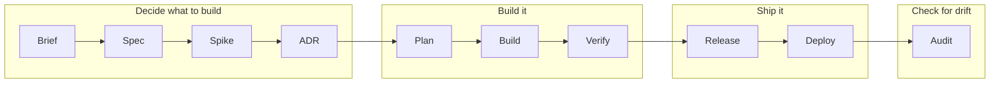
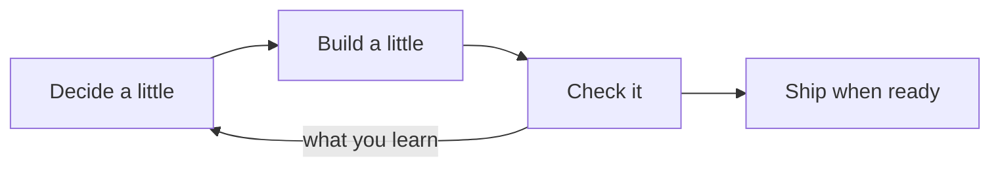
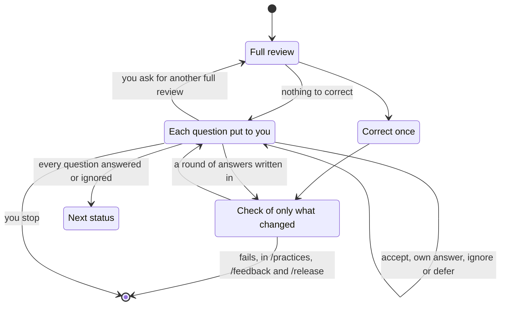
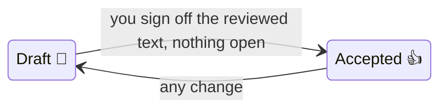
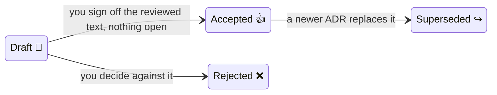
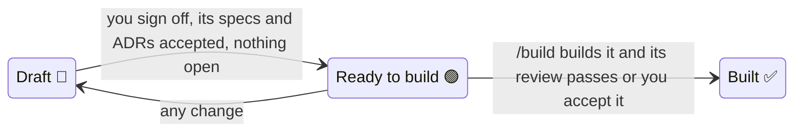
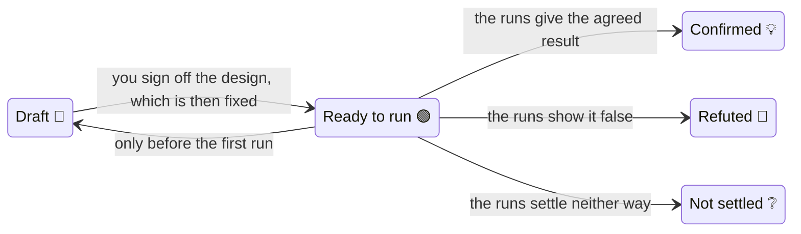
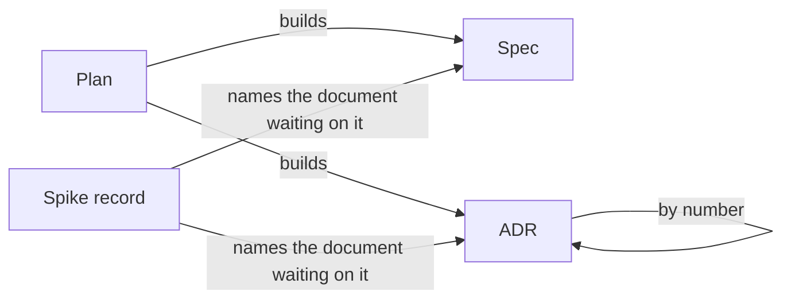
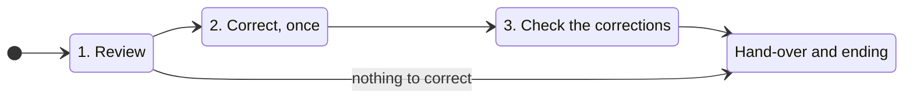

# The lifecycle

The lifecycle is how this plugin builds software with a coding agent. A few short documents say
what to build and why, a plan says how, and skills, instructions an agent follows that you run as
slash commands such as `/agentic:spec`, write and act on them. It fixes the shape of the documents
and leaves how you work to you.

An agent is given this page at the start of every session in a repository with a brief or a spec, so
it knows how the skills fit together even when you run only one, and every skill reads it for the
rules they share. Skills appear here without their `agentic:` prefix.
The [README](../README.md) lists the skills and covers installing the plugin.



Each step uses what an earlier one wrote, though not every piece of work needs every step: a
spike runs only when there is an unknown to settle, and an audit can run at any time. `/release`,
for example, drafts its notes from the `Release-note:` line each `/build` leaves in its last commit.

This is the order within one small piece of work, not a plan for the whole project. You go round it
many times, each round deciding only what the next change needs, then building and checking it.
What you learn feeds the next round: specs are edited as you learn, a wrong decision is superseded
by a new ADR, and a plan is done with once built.



## How it works

### The documents

The lifecycle keeps its thinking in five kinds of document, each a Markdown file in your
repository's `docs/` folder:

- **Brief:** what the product is, who it is for and why.
- **Spec:** what one capability of the product should do, and how we will know it does.
- **ADR:** an architecture decision record, one technical decision and why it was made.
- **Plan:** one piece of work that builds part of a spec or an ADR.
- **Spike record:** one hypothesis tested by a throwaway experiment, with its code, every run's
  output and the finding.

Every kind but the brief has a status, which says how far along the document is, not whether the
software does what it says: that is found by checking the software against it.

How long each lasts decides what may refer to it:

- **Lasting:** the brief, specs and ADRs, the project's record. They stay while true, and change by
  being edited (the brief and specs) or superseded (ADRs).
- **Temporary:** plans and spike records. Once built or finished they are never changed again, and
  they may be deleted whenever nobody needs them, so nothing [refers](#references) to them.
- **Throwaway:** the reports of reviews, `/build`, `/verify` and `/audit`. They never enter the
  repository: each is given in the reply or written to the session's scratchpad (in a session
  without one, the system's temporary folder), and lasts only as long as that folder.

Each kind's file, rules and statuses are under [Documents](#documents).

### You decide

The skills draft, check and propose; you decide. Three kinds of decision are always yours:

- **What the documents say.** The lifecycle fixes only what makes its documents worth trusting:
  what each one holds, that it is reviewed, and that a person signs it off. No document becomes
  `Accepted 👍`, `Ready to build 🟢` or `Ready to run 🟢` until you sign off its reviewed text.
- **How you work.** The skills set the shape; your practices set the rules. Everything else is
  yours to choose, such as how you test, branch, review code, open pull requests, merge, release
  and deploy, and how strict to be. You record those choices once as practices, with
  [`/practices`](skills/practices.md), and every skill follows them. The plugin never asks you to
  work its way where you have already chosen your own.
- **Anything that leaves your hands.** No skill merges or opens a pull request: `/build` works on
  a branch of its own and pushes it, and what happens to that branch is yours to decide. It never
  starts the product, so it can run on any machine; `/verify` does that where the product runs.
  `/release` publishes and `/deploy` deploys only when you say so, and `/deploy` and `/feedback`
  write nothing to your repository. Checks change nothing: `/verify` and `/audit` report what they
  find, and you choose what follows.

### How a document is reviewed

No agent checks its own work. Every document a skill writes is checked by separate agents that
start without the conversation, so they read it as a newcomer would. Each document is reviewed once
and corrected once, then only what changes is checked, and you decide each question. A full review
after every round of answers always finds new questions, so it would never end. Tests on specs
with planted mistakes showed one review finds nearly all of them.



#### The reviewer agent

Each skill that writes a document has its own, such as `agents/spec-reviewer.md`. It checks the whole document against the
skill's rubric, a short list of pass-or-fail checks such as "each requirement has exactly one
rule", which also guides the skill as it writes. It reports pass or fail for each check, quoting
the words that break it.

#### The language checker agent

`agents/language-checker.md`, shared by every skill that writes a document, runs beside the
reviewer and checks for words a newcomer could not follow, by the [Plain words](#plain-words) rule.
Alone, it finds more of them than the same rule added to every rubric.

#### The correction checker agent

`agents/correction-checker.md`, also shared, runs after the corrections and after each round of
your answers. It judges only what changed since the review or the last check: each correction
made, each answer written in as you gave it, nothing broken. What a change leaves uncovered comes
back as a question, never a failure.

#### What they report

| Finding | Meaning |
|---|---|
| **Failure** | Breaks a rubric check, or is another mistake the review lists. The skill corrects it, or, when it can't, asks you. |
| **Question** | Only you can settle it, such as which of two readings you meant. A report lists these under Needs a person. |
| **Suggestion** | Something you might act on. It never holds a document back. |

#### Signing off

At the end you read the document, shown as [Showing a file to you](#showing-a-file-to-you) says,
with the reports, and pick its next status on the last question. A status
that needs a review, such as `Accepted 👍`, is set only once the last review or check of the text
as it stands has run, with every question it raised answered or ignored and nothing deferred. The
record of the last check lasts only one conversation, so a new conversation starts with a full
review.

### How you are asked

When a skill needs you to settle something, it asks one question at a time, numbered such as
"Question 2 of 7", with the answer it proposes, and waits for yours. You accept the proposal, give
your own answer, ignore the question or defer it to the document's Open questions. The rule in full
is under [Asking you questions](#asking-you-questions).

---

The rest of this page holds the rules in full, for looking things up. Agents follow the whole
page.

## Documents

### Brief

File: `docs/brief.md`, one per product.

The brief has no status, since it is never built: it states the product's intent and is edited
in place.

- **The brief is the whole product.** It holds only what is true of the whole product; one
  capability's behaviour belongs in its spec.
- **The brief changes only when its intent does.** Detail a spec or ADR adds is never a reason to
  edit the brief, and no skill or agent proposes one. Only an outright contradiction of its Goals,
  Out of scope or Constraints counts: `/spec` asks you about one as the spec is written, and
  `/audit` finds any later. You settle it once, by changing the spec, superseding the ADR or
  changing the brief.

### Spec

File: `docs/specs/**/<subject>.spec.md`, one per capability.

- **Specs say what, never how.** A technical choice is an ADR.
- **One living spec per capability.** It is edited in place, and git is its history. A retired spec
  is deleted.



### ADR

File: `docs/adrs/NNNN-<subject>.md`, in one flat folder.

- **One decision per ADR.** A decided ADR is never edited or moved, apart from the `superseded-by:`
  field and status that mark it superseded. A new ADR supersedes it whole, each naming the other by
  number in its `supersedes:` and `superseded-by:` fields.
- **Only a person decides an ADR.** A person accepts or rejects it by explicitly signing off its
  final, reviewed text. No skill or agent does it for them.
- **No separate design document.** `Accepted 👍` ADRs and the code are the design.



### Plan

File: `docs/plans/YYYY-MM-DD-<subject>.md`, in one flat folder.

- **A plan builds only on settled documents.** A plan is `Ready to build 🟢` only when each spec and
  ADR it touches is `Accepted 👍`, and no two plans that are not `Built ✅` name the same
  requirement. `/build` builds a plan that isn't signed off only when you choose to, building its
  open questions' proposed answers, and its first commit says what wasn't signed off.
- **A plan holds nothing later work needs.** A decision later work must follow is an ADR; one a
  user or caller relies on belongs in the spec; one every piece of work follows is a practice. A
  reason someone changing the code later needs is a comment beside the code.



### Spike record

File: `docs/spikes/YYYY-MM-DD-<subject>.md`, in one flat folder.

Once a spike record is `Ready to run 🟢`, its design is fixed and only the run script adds runs.

- **A spike's finding goes to its owner.** `/spike` edits neither spec nor ADR: you take a fact to
  `/spec` and a choice to `/adr`.



### What every document shares

- **Frontmatter**, the settings block at the top of the file:

  ```yaml
  type: ADR               # Brief, Spec, ADR, Plan or Spike, so the title never says it
  number: 0007            # ADRs only: the four digits the file name starts with
  status: Accepted 👍     # all but the brief: word, then emoji
  date: 2026-11-19        # the day the status was set
  ```

  A status written emoji first, by an earlier version, still counts, and is rewritten the next time
  a skill edits it.
- **File name**: a number or date where the kind has one, then two to five lowercase words of the
  title joined by hyphens, so the name never has to change, least of all during a review.
- **Plain first**: an ADR or spike record opens with a part for people, then technical detail. An
  ADR's plain part, from the question to the open questions, is at most 500 words, leaving out
  diagrams of the chosen option; a spike record's is at most 600 for its design and 400 for its
  verdict.
- **Open questions**: what only you can settle and chose to defer (and, in a plan, the changes it
  waits on), or "None.". Each question has a numbered heading, its context, then a quote with the
  proposed answer and why; a question with two answers is two questions. An older document keeps
  its layout until its Open questions next change.

```markdown
### 1. Where the daily tariff copy is kept

The tariff is copied every day, but where it is kept is not yet chosen.

> **Proposed:** Object storage, one file per day.
>
> **Why:** The copy is read whole once a day and never searched.
```

### Where documents live

A repository is one product, so every `docs/` path on this page is counted from the top of the git
repository, wherever in it the session started, or from the session's folder in a project without
git. A monorepo, several related apps or packages in one repository, keeps one `docs/` folder at
its top; its specs may be grouped into folders, such as one per app, which carry no meaning.

## Principles

### References

Documents refer to one another only where neither end can go stale. A reference is any pointer to
another document: a hyperlink, a path or a title.



- A plan refers to the specs and ADRs it builds, and a spike record to the document waiting on
  its finding: once built or finished, each is a record of how those documents stood.
- An ADR refers to other ADRs by number, linked to their files, since a decided ADR never moves.
- Nothing refers to a temporary document. Otherwise the brief, specs and ADRs never refer to one
  another in any way: either end could change or be deleted without the other being touched. A
  spec or ADR that uses a spike's finding states its evidence in its own words.
- **Documents stand on their own.** Every document links only to the lifecycle's documents, as
  above, and to the web. Material it was drafted from, such as notes, a requirements document or a
  ticket, is stated in its own words, never referred to by hyperlink, path or title, when it was
  handed over in a conversation, lives outside the repository or sits under `docs/` beside the
  lifecycle's documents. Code is named only as plain text, such as a path in backticks, never
  linked. Each can change or vanish without the document being edited. A project may keep
  other files under `docs/`, and the lifecycle leaves them alone.

### Status changes

- **No document moves forward with open questions.** Anything only you can settle is put to you,
  one question at a time, and written into Open questions only if you defer it. A spec or ADR
  becomes `Accepted 👍`, a plan `Ready to build 🟢`, and a spike record `Ready to run 🟢` or
  finished only when that section is empty.
- **Only legal status moves.** Only the moves in the status diagrams under [Documents](#documents)
  are allowed, and only `/build` sets a plan `Built ✅`.
- **Drift is a finding, not a status.** `/audit` reports it with a suggested correction: correct
  the code, return the spec to `Draft 📝`, or supersede the ADR.

### Practices

- **Practices are not a lifecycle document** and have no status. Their essentials live in
  `AGENTS.md`, which coding agents load, and longer topics in `docs/practices/`. Every skill sees
  them, and `/plan` and `/build` follow them.
- **Every practice step is one command.** A step the practices record, such as running the tests,
  is one line that a skill runs as written, filling in any `{name}`, and judges by its exit code.
  It calls a runner entry, a script or a tool's standard command with nothing else of the
  project's own; anything more is a script in the project's scripts folder, written only by
  `/practices` or a build.

## Rules the plugin enforces

Some of the rules above matter too much to rest on an agent remembering them, so the plugin checks
them itself. Before an agent saves a change to a lifecycle document with its file-editing tools, a
small script the plugin
installs, called a hook, checks the change and refuses it, saying why, if it would break one of
these rules:

- a status change the status diagrams do not allow, or one that does not set `date:` to that day;
- an edit to a decided ADR, other than marking it superseded, or to a finished spike record; or
  an edit to a `Ready to run 🟢` spike record's design, or to its runs other than by its run
  script;
- a new document whose file name breaks the naming rule, or an edit that drops one of its name's
  words from the title;
- an ADR whose `number:` does not match its file name;
- Open questions laid out any other way than above;
- in any lifecycle document, a link to anything but another lifecycle document or the web, such as
  code, a folder, another page under `docs/`, or something outside the repository. A code file named
  as plain text is allowed.

Another hook runs before an agent creates or edits a pull request, with a GitHub tool or with
`gh pr create` or `gh pr edit`. It refuses a description holding a link longer than 150 characters,
since GitHub can show one as plain text instead of a working link. Pin file links to the commit's
7-character id to keep them short. It also refuses a `gh` description it cannot check because it is
not written out yet, such as a file the same command writes or a link built from a shell variable:
write the description in one command and run `gh` in the next.

## Plain words

This is the rule the skills write to and the language checker applies.

Every document the plugin writes, including an issue it files, is for a reader new to the project:
someone with a computer science degree but no knowledge of the product's field or of the
conversations behind it.

- **Computing terms**, such as "cache", "idempotent" or "HTTP", are used freely, and so are the
  product's own name and job titles that say what the person does, such as "accounts clerk".
- **Domain terms**, words from the product's own field such as a trade, legal or business term,
  get a Markdown footnote (`[^1]`) defining them where they first appear, unless that sentence
  already explains them. A domain term that is an acronym, such as "OTIF" for "on time, in full",
  gives its full form in the footnote. A title cannot hold a footnote, so a domain term in a title
  is defined at its first use in the text. Each document defines its own terms, so it never
  depends on a glossary that could fall out of date.
- **Anything else a newcomer would not know** is rewritten in plain words or spelled out, never
  footnoted: a name used only inside the code or the team, an acronym that is neither a computing
  term nor a domain term, or a phrase whose meaning the reader would have to guess. Read every
  phrase literally, title included: a figure of speech, an idiom, a nickname for a situation or a
  word used in a special sense of the team's own fails even when a reader could guess it, and is
  replaced by the plain statement it stands for. For example, "the order hitchhikes on the nightly
  export" becomes "the order is included in the nightly export".

Issues, plans, spike records and practices are read by people and agents who use the lifecycle, so in them
the lifecycle's own terms, such as "spec", "ADR", "requirement" and `Ready to build 🟢`, the
plugin's commands such as `/agentic:build`, and the marks "(default)" and "(not set up yet)" that
`/practices` ends a practice with, count as plain too.

The rule covers only what the plugin writes. Your own documents, code and messages follow your
project's rules.

## Asking you questions

This is the asking rule. When a skill asks you to settle a question during the session, it uses the
parts of an open question: a bold line naming the question and its place in the count, such as
"**Question 2 of 7: where the tariff copy is kept**", then the context, the quote with its
proposal, and the question itself last.

- The first number counts the questions asked or settled in the session, across every document,
  the one being asked included, so it only goes up. The total adds those still open. The skill says
  in one line when an answer opens or settles others. An offer of diagrams is not counted: it comes
  once the counted questions are settled, under "Optional: diagrams".
- Where the agent has no question tool but can post a decision card, as in a Claude project thread, it
  asks in words as above, then posts the same question on a card you answer with a tap.
- A skill asks one question per reply and then waits for your answer before asking the next, even
  where its card or question tool returns at once, so only one question is ever waiting on you.

## Review process

Every skill that has a document reviewed follows these steps, written once, here;
[How a document is reviewed](#how-a-document-is-reviewed) explains them. In them "you" is the agent
running the skill and "the person" is the human it works with. The skill names its own reviewer, its
requests, its hand-over (the reply that gives the person the finished document and the reports)
and anything only it does. A review report lists its failed checks, then Other findings, Needs a
person (what only the person can settle) and Suggestions.

The sequence is fixed so it always ends with a clear result: further rounds of review find little
more, and each round of corrections brings new mistakes.



1. **Review.** At the review step, start two agents in the foreground, not in the background,
   both in one message so they run side by side: the skill's reviewer and the
   `agentic:language-checker` agent. Give each the request the skill shows, laid out exactly as
   shown: a plugin hook reads its first line, and for a draft its `=== DRAFT ===` and
   `=== END DRAFT ===` lines, to keep a copy of the document as reviewed. A draft never saved as a
   file keeps the `Document:` line its skill shows. Every other review follows this rule. Give the
   document's full path on the `Document:` line, the one you wrote it to: the hook works out the
   document's repository from it, so the review reads the right one whatever folder you started in. If it
   refuses to start them, do what its reason says. Each reads everything else it needs itself. Wait
   for both reports before changing the document.
   If both pass with nothing under Needs a person, go straight to the skill's hand-over.
2. **Correct, once.** Read the rubric and the Plain words rule again, then correct only what the
   reports list: each failed check and each item under Other findings in the review report, and each
   finding in the wording report. A wording item under Needs a person, whose meaning only the person
   knows, is a decision like any other. A decision under Needs a person, and any finding the skill
   names as the person's to settle, is not written into the document: it becomes a question for the person, with the answer you would propose,
   never a guess written in as settled. Leave suggestions alone and change nothing else, since an
   edit beyond the reports is the likeliest way to break something. Wait until every edit has
   succeeded. If nothing in the reports was yours to correct, there is nothing to check: go
   straight to the skill's hand-over.
3. **Check the corrections.** Start the `agentic:correction-checker` agent in the foreground with
   the request the skill shows, and add nothing to it: the hook attaches both reports and the
   document as reviewed, word for word. If the hook refuses to start it, do what its reason says.
   What a failed check leads to is the skill's ending, below. Do not review or correct again; what
   happens next is their call.

After the sequence, edit the document only as the person's answers say, or when they ask.

### Ending with your answers

/brief, /spec, /adr, /plan and /spike end this way. If the check fails, change the document no
further, beyond writing in what the person defers: show the person the check's report, quoting
each finding as it gives it, and its findings become questions, as below. After the skill's
hand-over, every question, including those you raise while drafting, is taken this way.
When the person has said not to ask now, such as "don't ask me anything until it passes", ask
nothing at the hand-over, even after a failed check: still show a failed check's report, then
write each question into Open questions with its proposal, as Defer does, and give only the count.

While drafting, keep your own questions out of the document: ask them with the review's, once where
both raise the same point, so only a deferred one reaches Open questions.

Put each question to the person one at a time, by the asking rule: open questions, decisions for the
person and what a check finds. Offer four choices on your question tool: "Accept" your proposal, "My
own answer", "Ignore" and "Defer"; where you have none, end it with this line, word for word, since
a plugin hook looks for it to keep the answer: "Accept, give your own answer, ignore or defer?".
Where you can post a decision card, as in a Claude project thread, then post the same question on
one, its options named exactly "Accept", "Ignore" and "Defer", your proposal recommended; a plugin
hook reminds you. If the person has said not to ask now, or stops, defer the questions left.

The person may answer in chat instead, in every place: in the command line or the desktop app, by
writing a message instead of picking on your question tool; in a project thread, by writing instead
of tapping the card. Take the answer from their message as you would from a pick, and ask again
only when it settles nothing. Once a check has run, a plugin hook keeps every message they write,
in order, for the next check.

Accept and My own answer write the answer in as the person gave it, removing the question from Open
questions if it is there; Ignore writes nothing and removes it; Defer leaves it there, or writes it
there with its proposal. Nothing else is written into Open questions. An ignored fault you cannot
fix leaves the document as it is: say which rubric check it fails.

When a round of questions ends and an answer was written in, start the `agentic:correction-checker`
agent again with the same request: the hook attaches the text as last checked and the answers, so it
checks only what changed. A deferred or ignored question changes nothing else, so it needs no check.
Put what it raises to the person the same way. Never run a full review for
answers.

Once nothing is left to ask, the last question offers the next status, where there is one, one more
full review, or stopping; while any question is deferred, only the last two. Run a full review again
only when the person asks, after their own change, on a document rewritten to a new layout, or in a
new conversation.

### Ending on a failed check

/practices, /feedback and /release end this way. If the check fails, stop: change the document no
further, and show the person the check's report, with the draft where there is no file. While you
are walking through questions with the person, do not review after each answer: run the sequence
once when the walk-through ends, either because no questions are left or because the person stops. A
change the person makes or asks for at any other time is reviewed once it is made.

### Building

/build runs its own review sequence for code, with its own reviewers and correction checker, as
its [page](skills/build.md) describes.

## Showing a file to you

When a skill hands you a file it wrote or changed, such as a document to review or a report, the
agent shows it the way the place you work in needs, so that you can open it. This is written once,
here, and every skill points to it ([ADR 0055](adrs/0055-show-file-lifecycle-page.md)).

- **Claude Code command line:** the agent names the file's full path.
- **Claude Code desktop:** the agent opens the file in the Files pane and names its full path.
- **Claude project thread:** the agent copies the file into the project's shared files folder,
  `/mnt/project-files/`, under a folder named after the repository, so files of the same name from
  two repositories stay apart, attaches the copy to its reply and names the copy's path. After each
  change it copies and attaches the file again, since what you see is a copy.
- **Everywhere:** the agent never sends you to a code-hosting site to read the file.

The agent tells the places apart by what it is given. A project thread's instructions name the
shared files folder and give it a way to attach files to its replies; Claude Code desktop gives it a
way to open a file in the Files pane. Given neither, it is on the command line.
