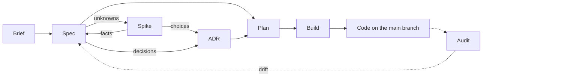
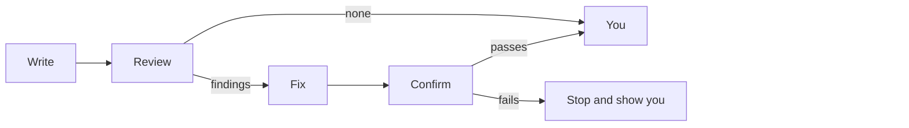

# The lifecycle rules

This page holds the whole lifecycle: the documents it keeps, the steps that write them, the
principles they follow and how every document is reviewed. The plugin gives this page to Claude
at the start of every session in a repository that has a brief or a spec, so Claude knows how the
steps fit together even when you run only one of them. The [README](../README.md) introduces the
plugin and how to install it.

## Documents

The lifecycle keeps its thinking in four kinds of document, each a Markdown file in your
repository. Every document except the brief has a status, the `status:` field in its frontmatter,
which says how far along it is.

- **Brief**, `docs/brief.md`: what the product is, who it is for and why. One per product,
  holding only what is true of the whole product. No status; it is never built, only kept true,
  and edited in place.
- **Spec**, `docs/specs/**/<capability>.spec.md`: what one capability of the product should do,
  and how we will know it does. A product has many. Statuses: Draft → Ready to build → Built; any
  change returns it to Draft.
- **ADR** (architecture decision record), `docs/adrs/NNNN-<title>.md`, in one flat folder: one
  technical decision and why it was made. Statuses: Draft → Accepted or Rejected; Accepted →
  Superseded.
- **Plan**, `docs/plans/`: a piece of work that builds part of a spec or an ADR. Statuses: Draft →
  Ready to build. `/build` deletes it in the commit that merges its work.

## Steps

Each step has a skill: instructions Claude follows for that step, which you run as a slash
command. The plugin's skills are named `/sdlc:<name>`, such as `/sdlc:spec`; this page leaves out
the `sdlc:` prefix. Some skills are not built yet, and only those Claude Code lists exist.

- `/brief` writes or changes the brief.
- `/spec` writes or changes the spec for one capability.
- `/spike` settles an unknown by a throwaway experiment, when one is needed. A fact goes back into
  the spec; a choice becomes an ADR.
- `/adr` records one technical decision.
- `/plan` scopes a piece of work against the specs and ADRs it delivers.
- `/build` builds a plan, has it reviewed and merges it into the main branch.
- `/audit` finds drift, where the code and its documents disagree, at any time.

## Principles

- **The brief is the whole product.** It holds only what is true of the whole product; one
  capability's behaviour belongs in its spec.
- **Specs say what, never how.** A spec says what the system does. A technical choice is an ADR.
- **One living spec per capability.** It is edited in place, and git is its history. A retired
  spec is deleted.
- **One decision per ADR.** A decided ADR is never edited or moved. A new ADR supersedes it whole,
  each naming the other by number in its `supersedes:` and `superseded-by:` fields.
- **Only a person decides an ADR.** A person accepts or rejects it by explicitly signing off its
  final, reviewed text. No skill or agent does it for them.
- **References never go stale.** Documents refer to one another only where neither end can go
  stale: a plan to the specs and ADRs it builds, since it is deleted once built, and an ADR to the
  ADR it supersedes or that supersedes it. The brief, specs and ADRs never refer to one another in
  any way, whether by hyperlink, path or title, because either end can change or be deleted
  without the other being touched, and the reference would quietly go stale.
- **No separate design document.** Accepted ADRs and the code are the design.
- **Every document carries its own status.** A plan holds nothing that would be lost when it is
  deleted.
- **Only legal status moves.** Only the moves listed under [Documents](#documents) are allowed,
  and only `/build` sets Built. A plugin hook refuses illegal spec and ADR status changes, and
  edits to decided ADRs, made with Claude's file-editing tools.
- **Built means every requirement is verified.** A spec is Built when `/build`'s spec reviewer
  finds every requirement in the whole spec verified, not just the part the plan built. `/audit`
  repeats that judgement later.
- **A plan builds only on settled documents.** A plan is Ready to build only when each spec it
  touches is Ready to build or Built, and each ADR it touches is Accepted.
- **Drift is a finding, not a status.** `/audit` reports it with a suggested way back: fix the
  code, return the spec to Draft, or supersede the ADR.

## Review process

Agents don't mark their own homework. The agent that writes a document can miss its own
mistakes, so every document a skill writes is checked by a reviewer agent before a person sees
it. The reviewer is a separate Claude that starts fresh, without the conversation, so it judges
the page as a newcomer would. It checks the document against the skill's rubric: a short list of
pass-or-fail checks, such as "each requirement has exactly one rule". The same rubric guides the
skill while it writes.

Every review follows the same fixed sequence:

1. **Review.** The reviewer checks the whole document and reports pass or fail for each check.
   For each failure it quotes the check and the words that break it.
2. **Fix.** The skill fixes every finding it can, once. A choice only you can make becomes an
   open question for you, never a guess.
3. **Confirm.** A reviewer checks only that each fix landed and that no edit broke anything.
   Anything else it notices reaches you as a suggestion, not a failure.
4. **You.** You get the document with the reports. If the confirm check failed, the skill stops
   there and shows you why, rather than trying again.

A finding is one of three kinds. A **failure** breaks a check, and the skill fixes it. A
**decision** is something only you can settle, such as which of two readings you meant; it goes
to you as an open question. A **suggestion** is something you might want to add; it never holds
a document back.

There are no repeated rounds of review and fix. We measured this on specs with planted
mistakes: one review finds nearly every one, and each further round of fixes brings new
problems ([results](../experiments/review-seeding/RESULTS.md)).

`/build` follows the same sequence for code: the build agent fixes the reviewers' findings once,
and a confirm check follows. A clean review or a passing confirm merges the work into the main
branch; a failing confirm stops and asks for help.
