# The lifecycle

The lifecycle is how this plugin builds software with a coding agent: a few short documents say
what to build and why, a plan says how, and each step has a skill, a set of instructions Claude
follows, run as a slash command such as `/agentic:spec`. This page holds the whole of it, for you
and for Claude: Claude is given it at the start of every session in a repository that has a brief
or a spec, and every skill opens it for the rules it shares with the others. The
[README](../README.md) introduces the plugin and how to install it. This page leaves out the
`agentic:` prefix of each skill's name.

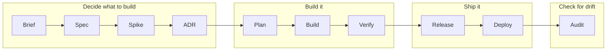

Each step uses what the one before it wrote. Not every piece of work needs every step: a spike runs
only when there is an unknown to settle, and an audit, shown last, can run at any time. Each phase
has its own, more detailed diagram under [Steps](#steps).

This is the order within one small piece of work, not a project plan done once from top to bottom.
You go round it many times: each round decides only what the next piece needs, such as one new
requirement in a spec or one decision, plans a change small enough to review in one go, builds it
and checks it. What you learn feeds the next round. A spec is a living document, edited whenever
you learn what a capability should do; a decision that turns out wrong is superseded by a new ADR;
a plan is thrown away once built.

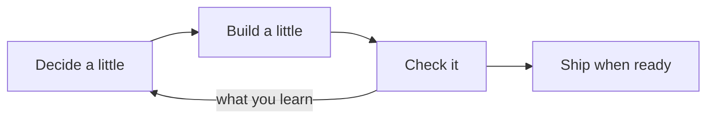

## Documents

The lifecycle keeps its thinking in five kinds of document, each a Markdown file in your
repository's `docs/` folder. Every kind but the brief has a status, which says how far along the
document is, not whether the software does what it says: that is found by checking the software
against it.

### Brief

`docs/brief.md`, one per product: what the product is, who it is for and why. It has no status,
since it is never built: it states the product's intent, is edited in place, and changes only when
that intent does.

### Spec

`docs/specs/**/<subject>.spec.md`, one per capability: what that capability should do, and how we
will know it does. Any change returns it to `Draft 📝`.

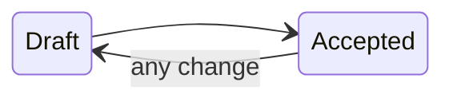

| Status | Meaning |
| --- | --- |
| `Draft 📝` | Being written or changed; plans cannot build on it yet. |
| `Accepted 👍` | You signed off its reviewed text, with no open questions left. Plans may build on it. |

### ADR

`docs/adrs/NNNN-<subject>.md`, in one flat folder: an architecture decision record, holding one
technical decision and why it was made. Once decided it is never edited, apart from the
`superseded-by:` field and status that mark it superseded by a newer ADR.

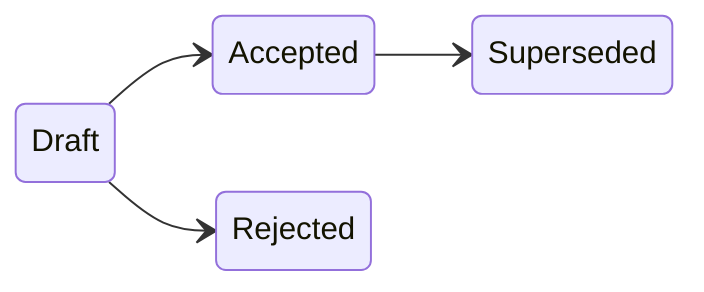

| Status | Meaning |
| --- | --- |
| `Draft 📝` | Being written: the decision is open, or chosen but not yet signed off. |
| `Accepted 👍` | You signed off its reviewed text. The code follows it, and it is never edited. |
| `Rejected ❌` | You decided against it. It stays as the record of why. |
| `Superseded ↪️` | A newer accepted ADR, named in its `superseded-by:` field, replaces it whole. |

### Plan

`docs/plans/YYYY-MM-DD-<subject>.md`, in one flat folder: one piece of work that builds part of a
spec or an ADR. Any change before it is built returns it to `Draft 📝`, and only `/build` marks it
`Built ✅`. It is temporary: once built it is never changed again, and it may be deleted whenever
nobody needs it.

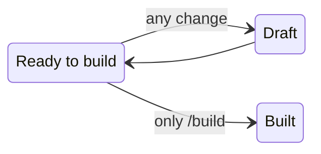

| Status | Meaning |
| --- | --- |
| `Draft 📝` | Being written or changed. |
| `Ready to build 🟢` | You signed it off, every spec and ADR it touches is accepted, and nothing is open. `/build` may build it. |
| `Built ✅` | `/build` built it and its reviews passed, or you accepted the build as it stood. Never changed again. |

### Spike record

`docs/spikes/YYYY-MM-DD-<subject>.md`, in one flat folder: one hypothesis tested by a throwaway
experiment, with its code, every run's output and the finding. Once `Ready to run 🟢`, its design
is fixed and only the run script adds runs. It is temporary: once finished it is never changed
again, and it may be deleted whenever nobody needs it.

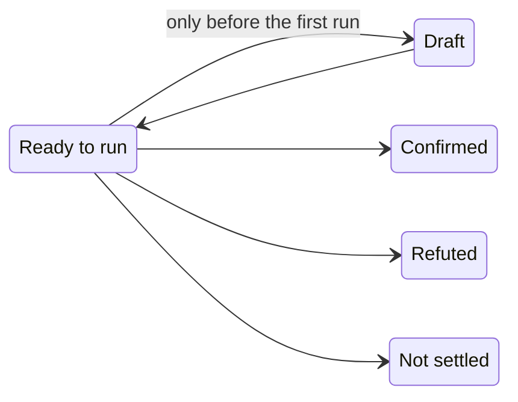

| Status | Meaning |
| --- | --- |
| `Draft 📝` | The experiment is being designed. |
| `Ready to run 🟢` | You signed off the design, which is now fixed; the run script adds each run. |
| `Confirmed 💡` | The runs produced the result agreed before the first run. |
| `Refuted 🚫` | The runs showed the hypothesis is false. |
| `Not settled ❔` | The runs settled it neither way. |

### What every document shares

- **Frontmatter.** The block of settings at the top of the file. Its `type:` field says what kind
  of document it is (`Brief`, `Spec`, `ADR`, `Plan` or `Spike`), so the title never needs to.
  Every document but the brief has a `status:`, written as its word then its emoji, such as
  `Accepted 👍`, and a `date:`, the day that status was set, as YYYY-MM-DD. An ADR's `number:`
  repeats the four digits its file name starts with. Documents written by earlier versions, with
  the emoji in front, still count, and are rewritten the next time a skill edits them.
- **File names.** A number or a date where the kind has one, then two to five lowercase words
  joined by hyphens, each a word of the document's title, so you know the file when you open it
  and its name never has to change, least of all while its review runs.
- **Reads plain first.** An ADR and a spike record start with a part for people, then the
  technical detail for agents and reviewers. An ADR's plain part, from the question to the open
  questions, is at most 500 words, diagrams of the chosen option left out; a spike record's is at
  most 600 for its design and 400 for the verdict written after the runs.
- **Open questions.** Every document has an Open questions section, holding what only you can
  settle and chose to defer (and, in a plan, the changes it waits on), or "None." when nothing is
  open. Each question has a numbered heading saying what is to be settled, the context it needs,
  then a quote holding the proposed answer and its reason. A question with two answers is two
  questions. A document written before this layout keeps it until its Open questions next change.

```markdown
### 1. Where the daily tariff copy is kept

The tariff is copied every day, but where it is kept is not yet chosen.

> **Proposed:** Object storage, one file per day.
>
> **Why:** The copy is read whole once a day and never searched.
```

### Where documents live

A repository is one product, so every `docs/` path on this page is counted from the top of the git
repository, wherever in it the session started, or from the session's folder in a project without
git. A monorepo, several related apps or packages in one repository, keeps one `docs/` folder at
its top; its specs may be grouped into folders, such as one per app, which carry no meaning.

## Steps

Each step has a skill. Most belong to one of three phases; the rest you run whenever you need them.

**Deciding what to build**

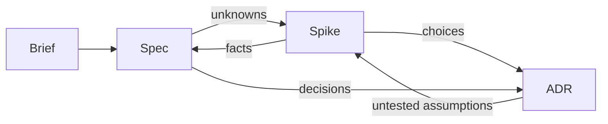

- [`/brief`](skills/brief.md) writes or changes the brief.
- [`/spec`](skills/spec.md) writes or changes the spec for one capability.
- [`/spike`](skills/spike.md) settles an unknown by a throwaway experiment, when one is needed. You
  take its finding to `/spec` (a fact) or `/adr` (a choice); `/spike` edits neither.
- [`/adr`](skills/adr.md) records one technical decision.

**Building it**

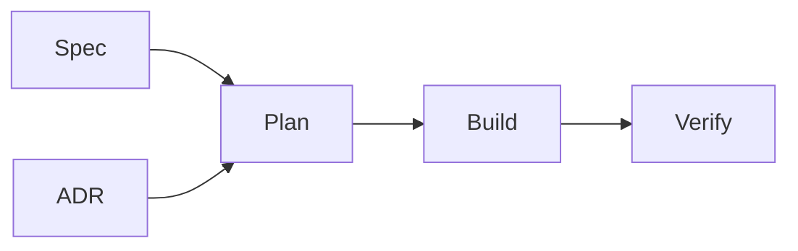

- [`/plan`](skills/plan.md) scopes a piece of work against the specs and ADRs it delivers.
- [`/build`](skills/build.md) builds a plan on a branch of its own, tests first, has it reviewed
  and pushes the branch to your remote. It never starts the product, so it can run on any machine,
  and never opens a pull request or merges.
- [`/verify`](skills/verify.md) checks the running product against accepted specs from the
  outside, usually before you merge. It changes nothing: you decide what follows.

**Shipping it**

- [`/release`](skills/release.md) makes a numbered release with notes for the product's users,
  by the steps your releasing practice records. It publishes only where the practice records a
  publish command, and only on your yes, and it never merges.
- [`/deploy`](skills/deploy.md) puts one release into one environment by the steps your deploying
  practice records, deploys only on your yes, and rolls back at once if its check fails. It writes
  nothing to the repository.

**Any time**

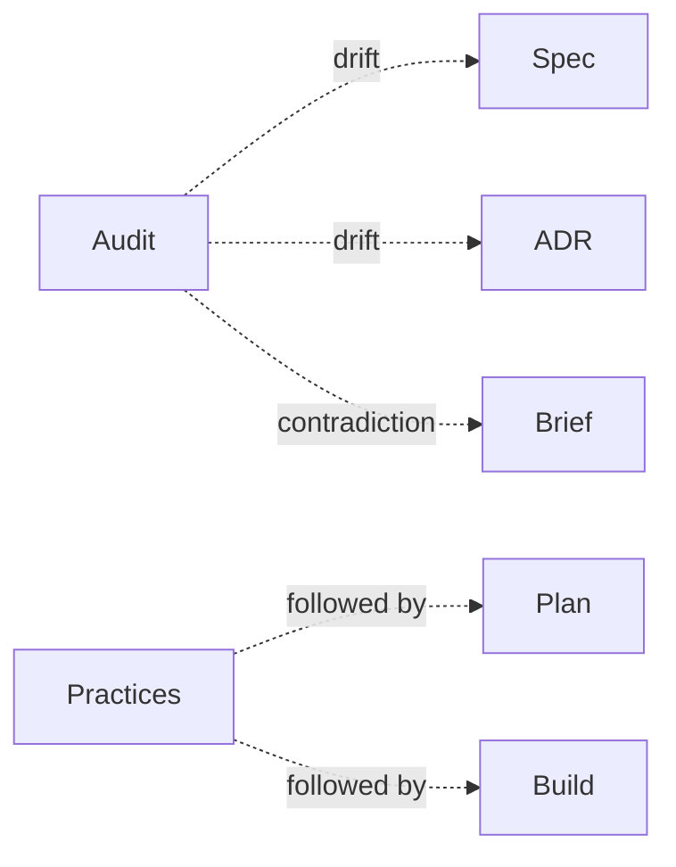

- [`/audit`](skills/audit.md) finds drift, where the code and its documents disagree, and any
  spec or ADR that contradicts the brief. It changes nothing: you choose each correction.
- [`/practices`](skills/practices.md) records how the project does things, such as the commands
  that check the work, for agents to follow. Practices are not a lifecycle document and have no
  status: their essentials live in `AGENTS.md`, which Claude Code loads, and longer topics in
  `docs/practices/`. Every skill sees them, and `/plan` and `/build` follow them.
- [`/feedback`](skills/feedback.md) drafts a GitHub issue about the plugin itself, when one of its
  skills gets something wrong or could work better. It writes nothing in your repository.

## Principles

### The brief

- **The brief is the whole product.** It holds only what is true of the whole product; one
  capability's behaviour belongs in its spec.
- **The brief changes only when its intent does.** Specs and ADRs add detail the brief never
  mentions, and that is never a reason to change it, so no skill or agent proposes an edit to the
  brief to match one. Only an outright contradiction counts: a spec
  or ADR that breaks the brief's Goals, Out of scope or Constraints. You settle it by changing the
  spec or superseding the ADR, or by changing the brief, and it is never raised again. `/spec`
  raises one while the spec is written, as a question to you; `/audit` finds any that appear later,
  such as after the brief changes.

### Specs and ADRs

- **Specs say what, never how.** A technical choice is an ADR.
- **One living spec per capability.** It is edited in place, and git is its history. A retired spec
  is deleted.
- **One decision per ADR.** A decided ADR is never edited or moved. A new ADR supersedes it whole,
  each naming the other by number in its `supersedes:` and `superseded-by:` fields.
- **Only a person decides an ADR.** A person accepts or rejects it by explicitly signing off its
  final, reviewed text. No skill or agent does it for them.
- **No separate design document.** `Accepted 👍` ADRs and the code are the design.

### Plans and spikes

- **A plan builds only on settled documents.** A plan is `Ready to build 🟢` only when each spec and
  ADR it touches is `Accepted 👍`, and no two plans that are not `Built ✅` name the same
  requirement. `/build` builds a plan that isn't signed off only when you choose to, building its
  open questions' proposed answers, and its first commit says what wasn't signed off.
- **A plan holds nothing later work needs.** A decision later work must follow is an ADR; one a
  user or caller relies on belongs in the spec; one every piece of work follows is a practice. A
  reason someone changing the code later needs is a comment beside the code.
- **Only an experiment settles a spike.** Documentation, other people's reports and reasoning help
  design it, but the finding rests only on what its runs produced, compared with the result agreed
  before the first run.

### References

Documents refer to one another only where neither end can go stale. A reference is any pointer to
another document: a hyperlink, a path or a title.

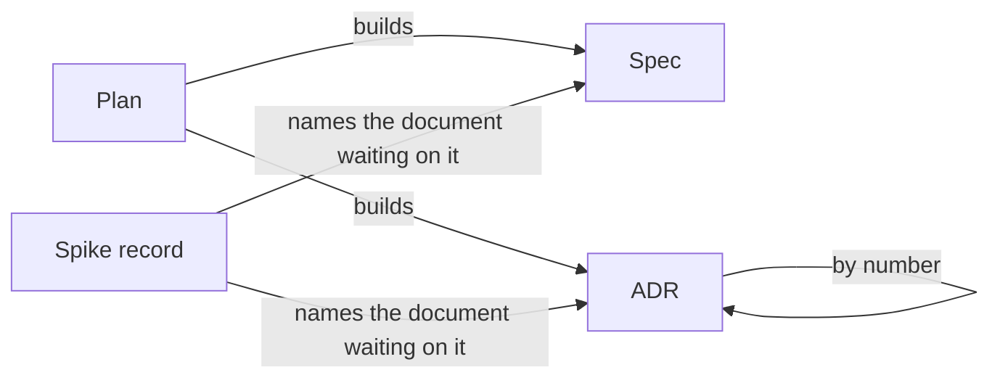

- A plan refers to the specs and ADRs it builds, and a spike record to the document waiting on
  its finding: once built or finished, each is a record of how those documents stood.
- An ADR refers to other ADRs by number, linked to their files, since a decided ADR never moves.
- Nothing refers to a plan or a spike record. Otherwise the brief, specs and ADRs never refer to
  one another in any way: either end could change or be deleted without the other being touched. A
  spec or ADR
  that uses a spike's finding states its evidence in its own words.
- **Documents stand on their own.** Every document refers to outside material only by a web link.
  Material it was drafted from, such as notes, a requirements document or a ticket, is stated in
  its own words, never referred to by hyperlink, path or title, when it was handed over in a
  conversation, lives outside the repository or sits under `docs/` beside the lifecycle's
  documents: it can change or vanish without them being touched, and `docs/` holds only the
  lifecycle's documents.

### Status changes

- **No document moves forward with open questions.** Anything only you can settle is put to you,
  one question at a time, and written into Open questions only if you defer it. A spec or ADR
  becomes `Accepted 👍`, a plan `Ready to build 🟢`, and a spike record `Ready to run 🟢` or
  finished only when that section is empty.
- **Only legal status moves.** Only the moves in the status diagrams under [Documents](#documents)
  are allowed, and only `/build`
  sets a plan `Built ✅`.
- **Drift is a finding, not a status.** `/audit` reports it with a suggested correction: correct
  the code, return the spec to `Draft 📝`, or supersede the ADR.

### Practices

- **Every practice step is one command.** A step the practices record, such as running the tests,
  is one line that a skill runs as written, filling in any `{name}`, and judges by its exit code.
  It calls a runner entry, a script or a tool's standard command with nothing else of the
  project's own; anything more is a script in the
  project's scripts folder, written only by `/practices` or a build.

## What the hooks refuse

A hook is a script the plugin runs at set moments, such as before Claude edits a file or starts an
agent. These refuse an edit made with Claude's file-editing tools, and say why:

- a status change the status diagrams do not allow, or one that does not set `date:` to that day;
- an edit to a decided ADR or a finished spike record, or to a `Ready to run 🟢` spike record's
  design and runs, which only its run script adds;
- a new document whose file name breaks the naming rule, or an edit that drops one of its name's
  words from the title;
- an ADR whose `number:` does not match its file name;
- Open questions laid out any other way than above;
- in any lifecycle document, a hyperlink or path to drafting material: something handed over in a
  conversation, outside the repository, or under `docs/` beside the lifecycle's documents. Web
  links and paths to code are allowed.

## Plain words

Every document the plugin writes, including an issue it files, is for a reader new to the project:
someone with a computer science degree but no knowledge of the product's field or of the
conversations behind it.

- **Computing terms**, such as "cache", "idempotent" or "HTTP", are used freely, and so are the
  product's own name and job titles that say what the person does, such as "accounts clerk".
- **Domain terms**, words from the product's own field such as a trade, legal or business term,
  get a Markdown footnote (`[^1]`) defining them where they first appear, unless that sentence
  already explains them. A domain term that is an acronym, such as "OTIF" for "on time, in full",
  gives its full form in the footnote. A title cannot hold a
  footnote, so a domain term in a title is defined at its first use in the text. Each document
  defines its own terms, so it never depends on a glossary that could fall out of date.
- **Anything else a newcomer would not know** is rewritten in plain words or spelled out, never
  footnoted: a name used only inside the code or the team, an acronym that is neither a computing
  term nor a domain term, or a phrase whose meaning the reader would have to guess. Read every
  phrase literally, title included: a figure of speech, an idiom, a nickname for a situation or a
  word used in a special sense of the team's own fails even when a reader could guess it, and is
  replaced by the plain statement it stands for. For example, "the order hitchhikes on the nightly
  export" becomes "the order is included in the nightly export".

Issues, plans, spike records and practices are read by people who use the lifecycle, so in them
the lifecycle's own terms, such as "spec", "ADR", "requirement" and `Ready to build 🟢`, the
plugin's commands such as `/agentic:build`, and the marks "(default)" and "(not set up yet)" that
`/practices` ends a practice with, count as plain too.

The rule covers only what the plugin writes. Your own documents, code and messages follow your
project's rules.

## Asking you questions

This is the asking rule. When a skill asks you to settle a question during the session, it uses the
parts of an open
question: a bold line naming the question and its place in the count, such as
"**Question 2 of 7: where the tariff copy is kept**", then the context, the quote with its
proposal, and the question itself last.

- The first number counts the questions asked or settled in the session, across every document,
  the one being asked included, so it only goes up. The total adds those still open. The skill says
  in one line when an answer opens or settles others.
- Where Claude has no question tool but can post a decision card, as in a Claude project thread, it
  asks in words as above, then posts the same question on a card you answer with a tap.
- A skill asks one question per reply and then waits for your answer before asking the next, even
  where its card or question tool returns at once, so only one question is ever waiting on you.

## Review process

No agent checks its own work. The agent that writes a document can miss its own mistakes, so
every document a skill writes is checked by a reviewer agent before you see it: a separate Claude
that starts fresh, without the conversation, so it judges the page as a newcomer would. It checks
the document against the skill's rubric, a short list of pass-or-fail checks, such as "each
requirement has exactly one rule", which also guides the skill while it writes. Beside it, the
language checker, shared by every skill that writes a document, reads it for words a newcomer
could not follow, by the [Plain words](#plain-words) rule.

Every document is reviewed once, corrected once, then only what changes is checked, and you
decide each question:

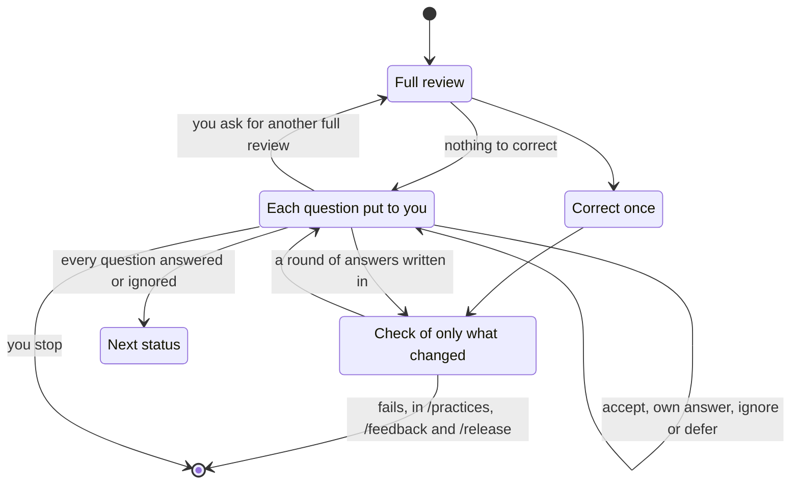

| Term | Meaning |
|---|---|
| **Review** | The skill's reviewer, such as `agents/spec-reviewer.md`, and `agents/language-checker.md`, run side by side on the whole document. Each reports pass or fail, quoting the check and the words that break it. |
| **Check** | `agents/correction-checker.md`, a separate Claude judging only what changed since the review or the last check: that each correction was made, each answer written in as you gave it, and nothing broken. A situation a change leaves uncovered comes back as a question, never a failure. |
| **Finding** | Anything a review or check reports: a failure, a question or a suggestion. |
| **Failure** | A finding that breaks a rubric check. The skill corrects it, or, when it can't, asks you. |
| **Question** | A finding only you can settle, such as which of two readings you meant. It reaches Open questions only if you defer it. |
| **Suggestion** | A finding you might act on. It never holds a document back. |

Each question comes with four choices. Accept and your own answer write the answer into the
document. Ignore writes nothing and takes the question out of Open questions if it is there, and a
fault you
ignore stays, with the skill saying which check it
fails. Defer writes the question into Open questions with its proposal, where it holds the
document back from its next status. At the end you read the document, shown in your Claude app's
file viewer where there is one and always named by its path, with the reports, and pick the next
status on the last question. A full review runs again only when you ask, after a change you make
yourself, on a document rewritten to a new layout, or in a new conversation, since the record of
the last check is kept only within one conversation. A status that needs a review, such as `Accepted
👍`, is set
only once the last review or check of the text as it stands has run, with every question it raised
answered or ignored and nothing deferred.

There are no repeated full reviews. We measured this on specs with planted mistakes: one review
finds nearly every one, each further round of corrections brings new problems, and a full review
after each round of answers always finds new questions, so the loop never ended. The wording has
its own checker because we measured that too: a checker that does only that job found more of the
jargon we added on purpose than the same rule added to each rubric.

### The steps

Every skill that writes a document follows these steps. They are written once, here, for Claude
to follow, so in this part "you" is Claude running the skill and "the person" is you, the reader.
The skill names its own reviewer, the requests it sends, its hand-over (the reply that gives the
person the finished document and the reports) and anything only it does. A review report lists
its failed checks, then Other findings, Needs a person (what only the person can settle) and
Suggestions.

The sequence is fixed so it always ends with a clear result: further rounds of review find little
more, and each round of corrections brings new mistakes.

1. **Review.** At the review step, start two agents in the foreground, not in the background,
   both in one message so they run side by side: the skill's reviewer and the
   `agentic:language-checker` agent. Give each the request the skill shows, laid out exactly as
   shown: a plugin hook reads its first line, and for a draft its `=== DRAFT ===` and
   `=== END DRAFT ===` lines, to keep a copy of the document as reviewed. Give the document's full
   path on the `Document:` line, the one you wrote it to: the hook works out the document's
   repository from it, so the review reads the right one whatever folder you started in. If it
   refuses to start them, do what its reason says. Each reads everything else it needs itself. Wait
   for both reports before changing the document.
   If both pass with nothing under Needs a person, go straight to the skill's hand-over.
2. **Correct, once.** Read the rubric and the Plain words rule again, then correct only what the
   reports list: each failed check and each item under Other findings in the review report, and each
   finding in the wording report. A wording item under Needs a person, whose meaning only the person
   knows, is a decision like any other. A decision under
   Needs a person, and any finding the skill names as the person's to settle, is not written
   into the document: it becomes a question for the person, with the answer you would propose,
   never a guess written in as settled. Leave suggestions alone and change nothing else, since an
   edit beyond the reports is the likeliest way to break something. Wait until every edit has
   succeeded. If nothing in the reports was yours to correct, there is nothing to check: go
   straight to the skill's hand-over.
3. **Check the corrections.** Start the `agentic:correction-checker` agent in the foreground with
   the request the skill shows, and add nothing to it: the hook attaches both reports and the
   document as reviewed, word for word. If the hook refuses to start it, do what its reason says.
   What a failed check leads to is the skill's ending, below. Do not review or correct again; what
   happens next is their call.

After the sequence, edit the document only as the person's answers say, or when they ask.

### Ending with your answers

/brief, /spec, /adr, /plan and /spike end this way. If the check fails, change the document no
further: show the person the check's report, whose findings become questions, as below. After the
skill's hand-over, every question, including those you raise while drafting, is taken this way.

While drafting, keep your own questions out of the document: ask them with the review's, once where
both raise the same point, so only a deferred one reaches Open questions.

Put each question to the person one at a time, by the asking rule: open questions, decisions for the
person and what a check finds. Offer four choices on your question tool: "Accept" your proposal, "My
own answer", "Ignore" and "Defer"; where you have none, end it with this line, word for word, since
a plugin hook looks for it to keep the answer: "Accept, give your own answer, ignore or defer?". If
the person has said not to ask now, or stops, defer the questions left.

Accept and My own answer write the answer in as the person gave it, removing the question from Open
questions if it is there; Ignore writes nothing and removes it; Defer leaves it there, or writes it
there with its proposal. Nothing else is written into Open questions. An ignored fault you cannot
fix leaves the document as it is: say which rubric check it fails.

When a round of questions ends and anything was written in, start the `agentic:correction-checker`
agent again with the same request: the hook attaches the text as last checked and the answers, so it
checks only what changed. Put what it raises to the person the same way. Never run a full review for
answers.

Once nothing is left to ask, the last question offers the next status, where there is one, one more
full review, or stopping; while any question is deferred, only the last two. Run a full review again
only when the person asks, after their own change, on a document rewritten to a new layout, or in a
new conversation.

### Ending on a failed check

/practices, /feedback and /release end this way. If the check fails, stop: change the document no
further, and show the person the check's report, with the draft where there is no file. While you
are walking through questions with the person, do not review after each answer: run the sequence
once when the walk-through ends, either because no questions are left or because the person stops. A
change the person makes or asks for at any other time is reviewed once it is made.

### Building

/build follows the same sequence for code, correcting what its reviewers find once, with its own
reviewers and its own correction checker,
`agents/build-correction-checker.md`, and no language checker, since it writes code. A clean
review or a passing correction check marks the plan `Built ✅`. When the correction check fails,
/build shows you the open findings at once and asks whether to accept the build as it stands or
leave it; if you accept, the plan is marked `Built ✅` and the commit that marks it lists the
findings you accepted. Running /build again on the branch reviews it afresh. Either way the work
stays on its branch until you merge it.

