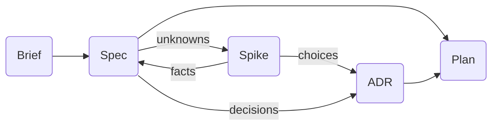
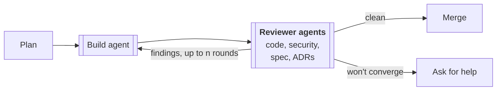

# The SDLC

How work moves from an idea for a product to code on main. This describes intent: what each
step is for, and what in the plugin carries it out.

The work runs in two stages. Planning decides what to build and how; it ends with a plan.
Building turns the plan into reviewed code on main.

In the diagrams, rounded boxes are skills you run with Claude in the conversation, and
double-edged boxes are agents that work on their own with a fresh context. Skills are invoked as
slash commands, shown below without the plugin's `/sdlc:` prefix. Underneath every step, a
plugin hook checks each change to a document's status, so the rules between documents always
hold; nothing is installed in your repo.

## Planning

### `/brief`

A high-level view of the whole product: what it is, who it is for and why. One per product;
every spec is written against it.

### `/spec`

What one capability of the product should do, and how we will know it does. Research is part of
writing it. A product has many specs.

### `/spike`

When an unknown can only be settled by trying something, we build a throwaway experiment before
the real work. A fact goes back into the spec; a choice becomes an ADR. *Claude frames the
question with you, then a spike agent runs the experiment in its own copy of the repo, so the
throwaway code never touches the real work.*

### `/adr`

One technical decision and why it was made, whether it came from a spike or straight from
shaping the spec. Written in [MADR](https://adr.github.io/madr/) format.

### `/plan`

A piece of work that delivers some part of a spec, an ADR, or both. *Written in Claude Code's
own plan mode; the skill adds the naming and header that tie it to its specs and ADRs.*

## Building

### `/build`

A build agent carries out the plan, then four reviewer agents check the result in parallel:

- **Code:** is it correct and well made? *(Claude Code's own review.)*
- **Security:** does it open any holes? *(Claude Code's own review.)*
- **Spec:** is everything the spec asks for built and shown to work, with nothing unrequested
  added?
- **ADRs:** is every accepted decision followed, not just the ones the plan touches?

Findings go back to the build agent for up to n rounds (a plugin setting, 3 by default). A clean
review merges the work to main; if it won't converge, we stop and ask for help.

## Audit

### `/audit`

Drift can still reach main outside this flow. This runs the spec and ADR reviewers across the
whole repo and reports what has drifted; you choose whether to fix the code, reopen the spec, or
supersede the ADR.
