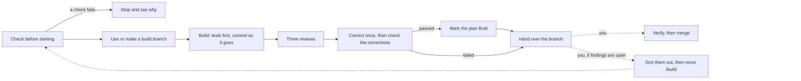

# `/build`

`/build` is the skill for building one plan. It is one step of [the SDLC](../../README.md); read
that page first for the documents, skills and agents it mentions.

## What `/build` does

`/build` takes one plan that you have signed off, writes the code and tests it describes on a
branch of its own, has the result reviewed, and hands the branch back to you.

## Your practices, and where `/build` stops

`/build` follows your project's practices: how to set up, build, test and run the product, how
branches and commits are named, and what must pass before work is merged. It finds them where
Claude Code finds any project instructions: in `CLAUDE.md`, or in `AGENTS.md` when there is no
`CLAUDE.md` or when `CLAUDE.md` imports it.[^memory] The `/practices` skill, run when you set a
project up, asks you about them and records them under a `## Practices` heading there. A choice
between alternatives, such as which test framework to use, is an ADR (architecture decision
record) instead.

`/build` stops once it has handed the branch back. These steps stay with you, done the way your
practices say, because each needs a person:

- **Verifying:** starting the product and using it, the way a person would, to check it does
  what was asked. A build may run on a machine that cannot run the product, with nobody
  watching, so this is a separate step. Claude Code's own `/verify` does it.[^verify]
- **Opening a pull request**, if you use them.
- **Merging** the branch into the main branch.

## Before it starts

Run `/sdlc:build docs/plans/<plan>.md` as the first thing in a new session. Before it changes
anything, `/build` checks:

- **The session is fresh.** `/build` starts only in answer to the first message you send in a
  session, or the first after `/clear`, whether you type the command or ask in your own words. A
  long planning
  conversation is a poor start for building: Anthropic's own advice is to start a fresh session to
  build from a written spec,[^fresh] so the build begins with a clean context and a written
  definition of done. A plugin hook enforces this, and if it refuses, it says why. In a Claude
  project, a new session is a new thread, and the note that opens a thread does not count as your
  message.
- **The plan is ready.** It is `🟢 Ready to build`. A `✅ Built` plan is refused: a plan is built
  once.
- **Nothing it relies on has changed.** Every spec the plan names is still `👍 Accepted`, and every
  ADR is still `👍 Accepted`. If one has changed since you signed the plan off, `/build` stops and
  says which.
- **Your practices are recorded.** `/build` looks for the `## Practices` heading. If it is
  missing, it suggests running `/practices` first. If you carry on without it, `/build` asks you
  now for anything it cannot build without, such as how to run the tests, so nothing needs asking
  once the build is under way.
- **It is on a branch of its own, with nothing left uncommitted.** `/build` never builds on your
  repository's default branch. If you are on it, it makes a branch named after the plan. If you are
  already on another branch, it builds there, since some places that run Claude Code, such as its
  cloud sessions, choose the branch name for you. If anything is uncommitted, it stops, so your
  own work never gets mixed into the build. While it runs, a plugin hook refuses any commit or
  push to the default branch.
- **It has a remote.** The repository needs a remote named `origin` whose default branch git
  knows, which `git clone` sets up. `/security-review` compares the branch with that default
  branch, and the hand-over pushes to it. If it is missing, `/build` stops and names the command
  to run, such as `git remote set-head origin -a`; it never runs that itself, since it would
  change your repository.
- **The reviews can run.** Claude must be allowed to start `/code-review` and `/security-review`,
  which a setting can turn off. If either is not, `/build` stops and says which, so every build
  gets all three reviews.

Finally, it runs your tests once. Any test that already fails is noted for the summary, and
`/build` does not try to fix it.

## Building

`/build` works through the requirements the plan names. For each one, it first writes tests from
the spec's scenarios and sees them fail, then writes the code that makes them pass. It then runs
your whole test suite and your linters, as your practices say, before moving on, so it notices at
once if the new code breaks something already built. It follows every `👍 Accepted` ADR the plan
names, and any other whose Confirmation section says it applies to the code being changed. It
commits as it goes, so the branch always holds the work so far.

Two rules hold throughout:

- **A test is never weakened to make the code pass.** `/build` changes a test only to make it
  check its scenario more closely.
- **Two attempts, then stop.** If a requirement's tests still fail after two attempts, `/build`
  stops and hands over with the failure written down, rather than keep retrying an approach that fails.
  Anthropic gives the same advice: after two failed corrections, start again rather than try a
  third.[^twice]

If a build stops halfway, for whatever reason, start a new session on the same branch and run
`/build` with the same plan again. It reads what the branch already holds, compares it with the
plan and carries on.

### Decisions

A plan cannot foresee everything, so `/build` meets choices as it goes. It may make a choice itself
only if the choice would not need an ADR or a change to a spec. That means it raises any choice
that would:

- be a lasting choice between real alternatives, such as a library, a data format, or the shape
  of an interface: that is what an ADR is for, and only you accept ADRs;
- change what a user sees in a way the spec does not settle;
- be hard to undo later, such as a database schema, a public interface, or data already stored;
- stretch or contradict a spec, an ADR, or your practices.

To raise one, `/build` stops and hands over with the question written down. It never guesses. A
build nobody is watching would otherwise carry on for hours on the wrong assumption.[^unattended]

Every other choice, such as names, how the code is split up, or which helper to use, `/build`
makes itself and carries on, and the summary lists each one with its reason, so you can see what was
decided for you.

A crash is never what a spec intends. When the code would crash on input no spec mentions, such
as a missing argument, `/build` makes it refuse that input plainly, in the way your code already
reports errors, and lists it in the summary. It raises the case with you only when what should
happen instead is a real product choice.

## Review

When the code is written, three reviews check it side by side, each run by an agent that has not
seen the conversation:

- **Code:** Claude Code's own `/code-review`,[^codereview] looking for bugs. `/build` always runs
  it at `medium` effort, and always compares the whole branch with the main branch, so a rerun
  reviews the whole build, not just its latest commits.[^localreview]
- **Security:** Claude Code's own `/security-review`, looking for security holes.
- **Plan:** the plugin's build reviewer. It checks that each requirement the plan names is built,
  with a test that checks each of its scenarios as the spec words it; that nothing unrequested was
  added; that the code follows the ADRs it must; and that no choice that should have been raised
  was made quietly. This is the review Anthropic suggests writing yourself: against your spec,
  reporting gaps that affect correctness and skipping style.[^specreview]

A reviewer asked to find problems will always find something, so the reviews pass once every bug
or security hole they report has been corrected. Findings about tidiness or style are listed in the
summary but do not stop the plan being marked `✅ Built`.[^specreview]

`/build` corrects what the reviews find, once, and has the corrections checked, the same way
documents are reviewed (see [Review process](../lifecycle.md#review-process)). It then runs your
tests and linters again.

## Handing over

However the build ends, a small script commits the branch and pushes it to `origin`. It does
this, not Claude, and reports exactly what happened, including the branch name and any failure
to push. `/build` never opens a pull request and never merges.

The plan is set to `✅ Built` only when every review has passed. If the build stopped instead,
because the corrections failed their check, a requirement's tests still failed after two attempts,
or a choice needed raising, the plan stays `🟢 Ready to build`. Sort out what is open however suits
you: with Claude directly, by changing a spec or ADR, or by deciding a finding is wrong. Then rerun
`/build` on the branch. It resumes, reviews again, and marks the plan Built once every review
passes. If you think a finding is wrong, say so when you rerun it.

It ends with a short summary:

- what was built, or why it stopped and what is open;
- the test and lint commands it ran, with their output, and any tests that were failing before it
  started;
- the decisions it made for you, each with its reason;
- what the reviews found, and what was corrected;
- a reminder to verify the work before merging.

## After a build

A `✅ Built` plan is kept as a record of what was built and how, like a superseded ADR. It is never
edited again, and whoever looks after the repository decides when, if ever, to delete it. For
more work on the same requirements, write a new plan,
or make small corrections by working with Claude directly, which is the usual way to tidy up after
a large build.

A spec's status does not change when it is built. It describes the document, not the software,
because a status about the software would stop being true, without anyone noticing, as the code
changes. To find out whether the software meets a spec, check the software against it.

[^verify]: Claude Code documentation, [Run and verify your app](https://code.claude.com/docs/en/skills#run-and-verify-your-app).
[^fresh]: Claude Code documentation, [Best practices: brainstorm with Claude first](https://code.claude.com/docs/en/best-practices#brainstorm-with-claude-first):
    "Once `SPEC.md` exists, start a fresh session to build from it, so the build begins with a
    clean context and a written definition of done."
[^codereview]: Claude Code documentation, [Best practices: give Claude a check to run](https://code.claude.com/docs/en/best-practices#give-claude-a-check-to-run):
    `/code-review` "reviews the diff in a fresh subagent that never saw your conversation".
[^specreview]: Claude Code documentation, [Best practices: review against your spec](https://code.claude.com/docs/en/best-practices#review-against-your-spec).
[^twice]: Claude Code documentation, [Best practices: steer the session](https://code.claude.com/docs/en/best-practices#steer-the-session):
    "after two failed corrections run `/clear` and write a better prompt instead of a third."
[^unattended]: Claude Code documentation, [Best practices: let Claude run without you](https://code.claude.com/docs/en/best-practices#let-claude-run-without-you):
    "you find out the next morning that it spent the whole night building on the wrong assumption."
[^localreview]: Claude Code documentation, [Review locally with /code-review](https://code.claude.com/docs/en/code-review-local).
[^memory]: Claude Code documentation, [How Claude remembers your project](https://code.claude.com/docs/en/memory#agents-md).
