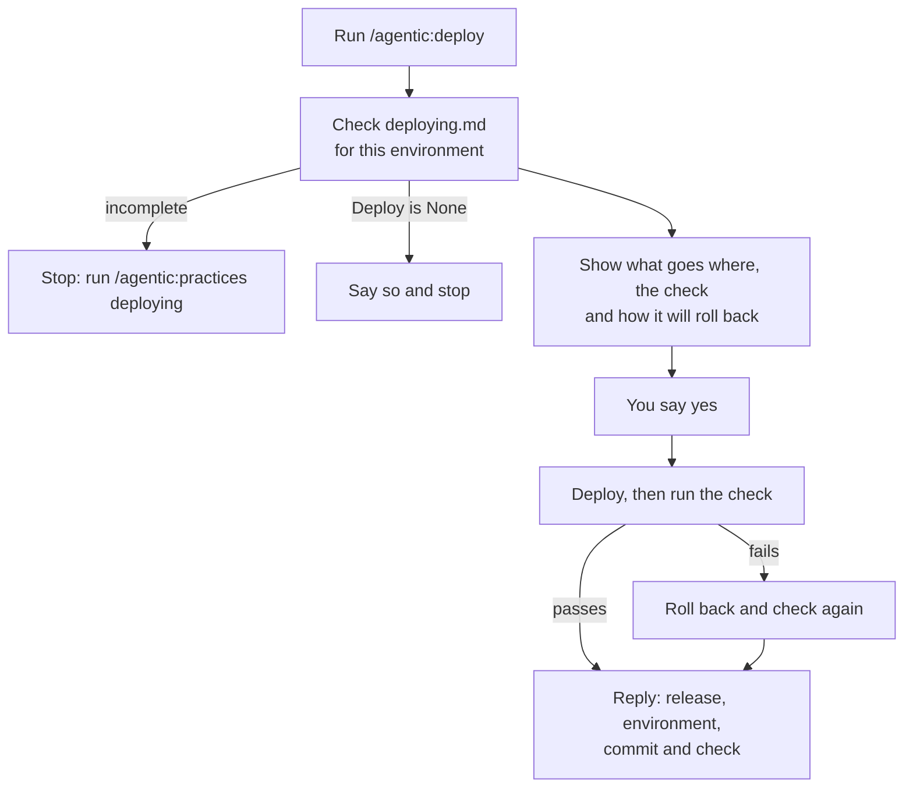

# `/deploy`

`/deploy` is the skill for putting one release into one environment, such as staging or
production, and making sure it works there. It ends one of two ways: the new release is running
and its check has passed, or the previous release is back and you know why. Its usual place in
[the lifecycle](../lifecycle.md) is after [`/release`](release.md), or after a merge for a project
that deploys any commit, but you can run it whenever your practice allows. Read that page first
for the documents, skills and agents it mentions.

## Why it exists

Getting a release onto a real machine and confirming it serves people is the step that touches
the live product, yet without a recorded way of doing it an agent works from memory or guesswork.
`/deploy` takes that guesswork out: it runs only the steps your project has recorded, it counts a
deploy as done only when the recorded check passes, and when the check fails it puts the previous
release back.

It is not [`/verify`](verify.md). `/verify` tries every example in the specs against a copy of the
product it is allowed to change. `/deploy`'s check is short and only reads, so it is safe to run
against production.

## Your deploying practice

How a project deploys differs too much from one project to the next for the plugin to choose, so
`/deploy` carries out the steps your project has recorded and decides none of them. It reads them
from `docs/practices/deploying.md`, which [`/practices`](practices.md) writes with you. The file
has one `## Environment: <name>` section per environment, each with these headings:

- `### Releases allowed`: which releases may go there, named by version or by commit, such as
  "any commit on `main`" or "only versions already on staging".
- `### Deploy`: one command, or a line starting `None:`, such as "None: merging deploys it". The
  command may take `{environment}`, `{commit}` and, when a version was named, `{version}`.
- `### Check`: one command that only reads and exits 0 when the product works, and how long to
  wait for it to pass.
- `### Roll back`: one command that puts the previous release back, or "None: stop and tell me".
  It takes only `{environment}`: the platform deployed to remembers what ran before, and `/deploy`
  keeps no record of its own.

Two optional headings sit at the top: `## Where it runs`, the machine and where its credentials
live, and `## How deploys start`, by hand or by the pipeline, and by whom. Where `Where it runs` is
missing, `/deploy` assumes this machine, with its credentials already set up, and says so.

Every step it runs is one command, as [the lifecycle rules](../lifecycle.md#practices) require.
Writing or changing one is the practices skill's job, never `/deploy`'s.

## How a run goes

1. **Pick the environment.** You name it; with only one recorded, `/deploy` uses that one.
2. **Check the practice.** It runs the practices skill's check, `practice_complete.py`, on
   `deploying.md`, judging only that environment, so a gap in another environment never blocks
   this one. If the file or the environment is missing, a heading is empty or still holds a
   default Claude proposed, or the step it needs is written as prose rather than a command, it
   changes nothing, says what is missing, lists the environments there are when yours isn't one,
   and asks you to run `/agentic:practices deploying`. If Deploy starts `None:`, it repeats what
   that line says, such as "this environment is deployed by merging", and stops.
3. **Pick the release.** You name a version or a commit, as Releases allowed says, or `/deploy`
   proposes the newest one allowed. A version is turned into its exact commit the way
   `docs/practices/releasing.md` ties the two; if it can't be, `/deploy` stops and says why. If
   the Deploy command takes `{version}` and you named only a commit, it stops and says so.
4. **Check what it can.** The commit must be on the remote, and nothing may be uncommitted. If the
   Deploy command does not take `{commit}`, the commit must also be the one checked out, since the
   command then works from the checkout; `/deploy` never checks out or changes branches itself.
   It says plainly when the commit is not on your repository's default branch. It checks what
   Releases allowed asks of the branch, the version and the commit. A rule it can't check, such as
   "only versions already on staging", becomes a question for you on the next screen, such as
   "Has 1.4.0 passed on staging? I can't check this."
5. **Ask for your yes.** It shows the release, its commit, the environment, the exact deploy
   command, the check, and how it will roll back if the check fails, with any questions from step
   4, and waits for your yes. Saying yes also agrees to the roll back.
6. **Deploy and check.** It runs the deploy command, then the check, repeating the check every few
   seconds until it passes or the recorded wait runs out; with no wait recorded, it checks once.
   If the deploy command itself fails, it runs the check once to show what state the environment
   is in, rolls nothing back, and stops.
7. **Roll back if the check fails.** It runs the roll back command at once, without asking, then
   the check again, so you know whether the previous release works. If Roll back is "None: stop
   and tell me", or the roll back command fails, it stops and tells you. It never runs a deploy or
   a roll back a second time on its own, since a step that half worked must be looked at by a
   person.
8. **Reply.** It names the release, the environment, the commit, the result of each check it ran
   with what a failed check printed, and any assumption it made. After a roll back it says the
   environment is back on the previous release, as the platform tracks it, since `/deploy` keeps
   no record of which release that was.

## What it never does

- **Choose a method.** Environments, commands, the check and the roll back all come from your
  practice.
- **Deploy without your yes,** or to more than one environment in one run: each environment is
  its own run, with its own yes.
- **Write to your repository.** It commits nothing and keeps no record of what it deployed; its
  reply is the record.
- **Handle secrets.** The recorded commands fetch the credentials they need from wherever `Where
  it runs` says they live; `/deploy` never reads, prints or stores them. If they can't be reached,
  the command fails and `/deploy` stops.
