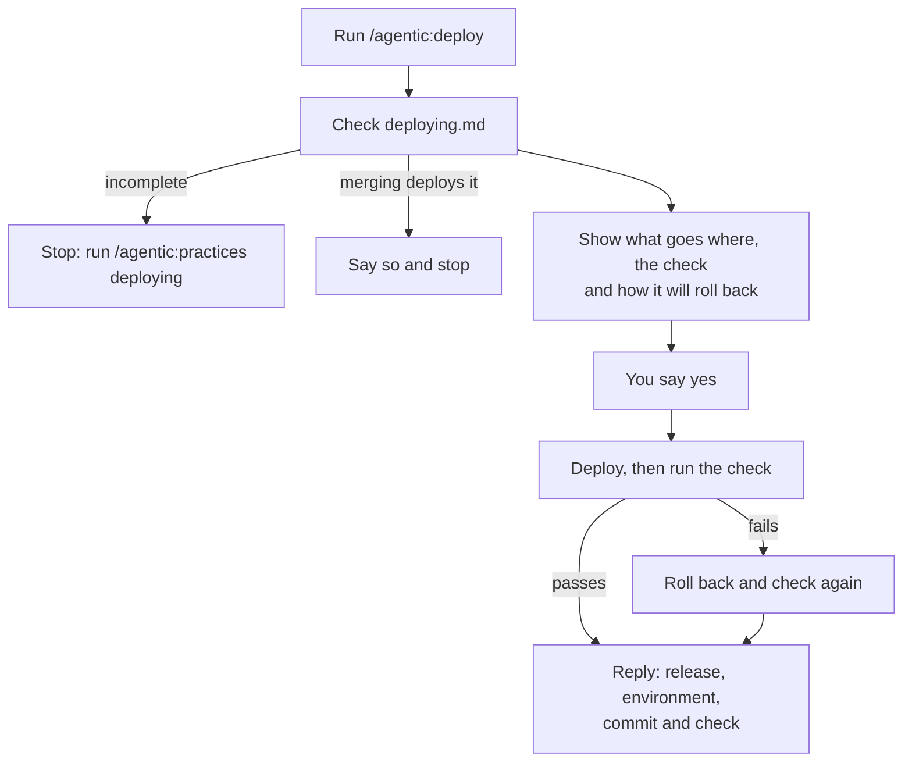

# `/deploy`

`/deploy` is the skill for putting one release into one environment, such as staging or
production, and making sure it works there. It ends one of two ways: the new release is running
and its check has passed, or the previous release is back and you know why. Its usual place in
[the lifecycle](../../README.md) is after [`/release`](release.md), or after a merge for a project
that deploys any commit, but you can run it whenever your practice allows. Read that page first
for the documents, skills and agents it mentions.

## Why it exists

Getting a release onto a real machine and confirming it serves people is the step that touches
the live product, yet without a recorded way of doing it an agent works from memory or guesswork.
`/deploy` takes that guesswork out: it runs only the steps your project has recorded, it counts a
deploy as done only when the recorded check passes, and when the check fails it puts the previous
release back.

It is not [`/verify`](verify.md). `/verify` tries every example in the specs against a copy of the
product it is allowed to change. `/deploy`'s check is short and only reads, so it is safe to run
against production.

## Your deploying practice

How a project deploys differs too much from one project to the next for the plugin to choose, so
`/deploy` carries out the steps your project has recorded and decides none of them. It reads them
from `docs/practices/deploying.md`, which [`/practices`](practices.md) writes with you. The file
has one section per environment, each with:

- **Releases allowed**: what you name when you deploy there, a version, tied to its commit the way
  your releasing practice says, or a commit, such as "any commit on `main`"; and which ones may
  go there, such as "only releases already on staging".
- **Deploy**: one command, which may take `{version}` and `{commit}`, or "None: merging deploys
  it".
- **Check**: one command that only reads, exits 0 when the product works, and how long to wait
  for it to pass.
- **Roll back**: one command that puts the previous release back, or "None: stop and tell me".
  It takes no values: the platform deployed to remembers what ran before, and `/deploy` keeps no
  record of its own.

Two optional items sit at the top: **Where it runs**, the machine and where its credentials live,
and **How deploys start**: by hand or by the pipeline, and by whom. Where one is missing, `/deploy` assumes it runs on this machine with
the credentials already set up there, and its reply says so.

Every step it runs is one command, as [the lifecycle rules](../lifecycle.md#principles) require,
and `/deploy` never writes or changes a command. Before it does anything, it runs the practices
skill's check, `practice_complete.py`, on `deploying.md`, keeping only the lines about the
environment you named. If the file is missing, or that environment is missing or incomplete, it
changes nothing, shows those lines, and asks you to run `/agentic:practices deploying`.

## How a run goes

1. **Check the practice**, as above. If the environment's Deploy is "None: merging deploys it",
   there is nothing to run: `/deploy` says the environment is deployed by merging, and stops.
2. **Pick the release.** You name a version or a commit, as Releases allowed says, or `/deploy`
   proposes the newest one allowed. A version is turned into its exact commit the way
   `docs/practices/releasing.md` ties the two; if it can't be, `/deploy` stops and says why. It
   says plainly when the commit is not on your repository's default branch.
3. **Check what it can.** It checks what Releases allowed asks of the branch, the version and the
   commit. A rule it can't check, such as "only releases already on staging", becomes a question
   for you on the next screen, such as "Has 1.4.0 passed on staging? I can't check this."
4. **Ask for your yes.** It shows the release, its commit, the environment, the exact deploy command, the
   check, and how it will roll back if the check fails, with any questions from step 3, and waits for your
   yes. Saying yes also agrees to the roll back.
5. **Deploy and check.** It runs the deploy command. If that fails, it stops and shows what it
   printed. Otherwise it runs the check, again until it passes or the recorded time runs out.
6. **Roll back if the check fails.** It runs the roll back command at once, without asking, then
   runs the check again so you know whether the previous release works. If Roll back is "None:
   stop and tell me", or the roll back command fails, it stops and tells you. It never tries a
   deploy or a roll back a second time on its own, since a step that half worked must be looked
   at by a person.
7. **Reply.** It names the release, the environment, the commit, and the result of each check it
   ran, with what the check printed when it failed, and any assumption it made.

## What it never does

- **Choose a method.** Environments, commands, the check and the roll back all come from your
  practice.
- **Write or change a command,** or run a step that has none.
- **Deploy without your yes,** or to more than one environment in one run: each environment is
  its own run, with its own yes.
- **Retry** a deploy or a roll back that failed.
- **Write to your repository.** It commits nothing and keeps no record of what it deployed; its
  reply is the record.
- **Handle secrets.** The recorded commands fetch the credentials they need from wherever "Where it
  runs" says they live; `/deploy` never reads, prints or stores them. If they can't be reached, the
  command fails and `/deploy` stops.
