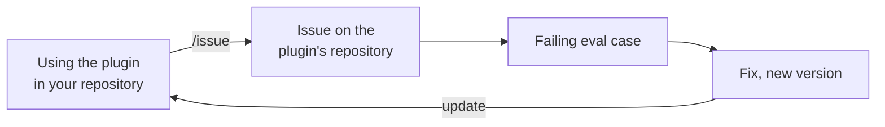

# `/issue`

`/issue` is the skill for telling the plugin's maintainers that something went wrong or could be
better. It is not a step of [the SDLC](../../README.md) itself; it is how the plugin that
encodes the SDLC improves. Read that page first for the skills, agents and documents it
mentions.

## The loop

1. **Report.** In any repository, you run `/issue` when a skill, agent or hook does something
   wrong, or the lifecycle gets in your way. It files an issue, a GitHub work item, on
   [michaelmarconi/sdlc](https://github.com/michaelmarconi/sdlc/issues).
2. **Reproduce.** A maintainer turns the issue into an eval case: a recorded request with checks
   on what Claude should do, which `claude plugin eval` runs against the plugin. The case fails
   while the problem exists.
3. **Fix.** The maintainer changes the plugin until the case passes, and releases a new version
   whose commit closes the issue.
4. **Update.** Your copy of the plugin picks up the new version the next time it updates.

The eval case stays in the plugin, so a later change that brings the problem back fails it.

## What it asks you

`/issue` takes what the conversation already shows, such as which skill you were using and what
it did, and asks only for what is missing, one question at a time: what happened, what you
expected, and whether it happens every time. It decides whether the issue is a **bug** (the
plugin did something wrong) or an **improvement** (it worked as designed, but could work
better).

## What the issue holds

Each kind has a template, a fixed set of headings[^templates]:

| Bug | Improvement |
|---|---|
| What happened | What got in the way |
| What I expected | What would be better |
| Steps to reproduce | |
| Context | Context |
| Proposed eval | Proposed eval |

Context gives the plugin, Claude Code and operating system versions, the skill involved, and the
documents involved described by kind and status, never by content. Proposed eval sketches the
eval case a maintainer would write, when the report is concrete enough for one; otherwise it
says "None" and why.

## Your project stays private

The plugin's repository is public, and your repository may not be. So `/issue` describes what
happened in its own words, rebuilds any example from stand-ins such as "a web app" or
`docs/specs/example.spec.md`, and quotes nothing from your repository. The draft is never
written into your repository.

Before you see the draft, a reviewer agent checks it against
[the issue rubric](../../skills/issue/references/rubric.md). Among other things, it searches
your repository for every name and phrase in the draft, since anything found there is a leak.
The skill fixes what the reviewer finds, once, and has the fixes confirmed (see
[How it works](../../README.md#how-it-works)).

## Filing

You see the draft exactly as it would be filed, with the reviewer's report. Nothing is filed
until you say yes. Then `/issue` files it with the GitHub command-line tool,
[`gh`](https://cli.github.com/), if that is installed and signed in. Otherwise it gives you a
link that opens GitHub's new-issue page already filled in[^query], and you press Submit. Ask for
the link if you would rather submit it yourself. Either way the issue appears under your GitHub
account, so `/issue` tells you which account before you say yes.

GitHub only applies labels, such as `bug`, for people allowed to label the repository's issues,
so the maintainer labels other issues when they read them.

[^templates]: GitHub Docs, [Configuring issue templates for your repository](https://docs.github.com/en/communities/using-templates-to-encourage-useful-issues-and-pull-requests/configuring-issue-templates-for-your-repository).
    The templates live in this repository's `.github/ISSUE_TEMPLATE/`, so issues filed by hand
    get the same headings.
[^query]: GitHub Docs, [Creating an issue from a URL query](https://docs.github.com/en/issues/tracking-your-work-with-issues/using-issues/creating-an-issue#creating-an-issue-from-a-url-query).
