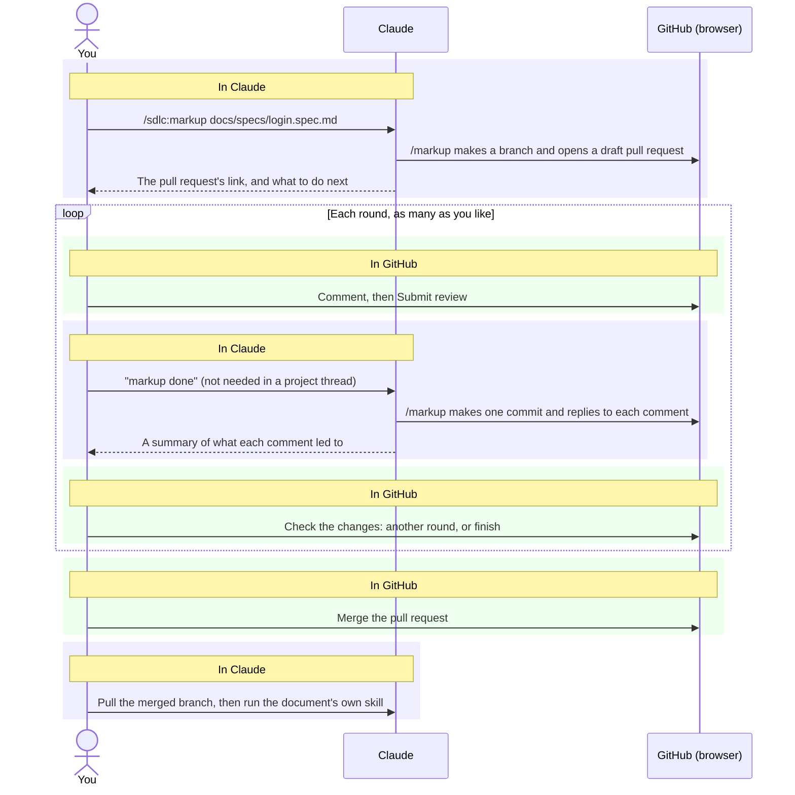

# `/markup`

`/markup` is the skill for reviewing one of your documents by marking it up: you read the whole
document, comment wherever you like, then hand every comment over at once. `/markup` changes the
document once and answers each comment. It is one step of [the software development lifecycle
(SDLC)](../../README.md); read that page first for the documents and skills it mentions.

Run it as `/sdlc:markup` with the document's path, for example
`/sdlc:markup docs/specs/login.spec.md`.

## What it covers

- **Documents:** the brief, and any spec, ADR, plan or spike record whose status is `📝 Draft`.
  The status is the field at the top of the document that says how far along it is.
- **Other statuses:** `/markup` stops. A spec or plan can go back to Draft with its own skill
  first; a decided ADR is replaced by a new one through `/sdlc:adr`, never edited; a built plan,
  a rejected ADR or a spike record past Draft is kept as it is.
- **One document per run.** To mark up another, run it again.
- **Not covered:** code and builds, which `/code-review` and `/build` review, and practices,
  which `/sdlc:practices` changes in conversation.

## What you need

`/markup` works through a GitHub pull request[^pr], so the repository must be on github.com and
`/markup` must be able to reach it, in one of two ways:

- on your own computer, through the GitHub command-line tool, [`gh`](https://cli.github.com/),
  signed in;
- in a cloud session on claude.ai, through the GitHub access connected to it.

If neither works, `/markup` stops before doing anything and says how to set one up. Running
`/markup` is your request for it to push a branch, open a pull request and reply on it.

## The journey

You switch between Claude and GitHub. The shaded bands show where you are.

A project thread is a Claude conversation inside a claude.ai project, watching the pull request
for you: when you submit a review, GitHub tells the thread and `/markup` starts on its own.
Anywhere else, you tell it "markup done".

## What you do in GitHub

**To comment**

1. Open the pull request's link, then the **Files changed** tab.
2. Press **expand all lines** in the file's header, so every line shows. Without it you see only
   the lines `/markup` changed. Do this again in each round.
3. Hover over a line and click the blue **+**; drag from it to cover several lines. To propose
   exact wording, use the suggestion button in the comment box.
4. Click **Start a review** for the first comment, then **Add review comment** for the rest.
   **Add single comment** sends that comment at once; `/markup` takes it in the next round.

**To hand over**

5. Click **Submit review**, choose **Comment**, and submit. **Approve** and **Request changes**
   are greyed out on a pull request opened under your own account; that is expected.
6. Tell `/markup` "markup done", unless you are in a project thread.

**To check the changes**

7. In **Files changed**, open the commits menu and choose **Changes since your last review**.
8. Open the **Conversation** tab to see each thread with its reply; GitHub folds a thread away as
   "Outdated" once its line changes. If a change is wrong, reply in that thread or unresolve it,
   then submit another review.
9. When you are happy, click **Ready for review**, then **Merge**, then **Delete branch**. A cloud
   session cannot delete branches for you.

To read the document as it will look, diagrams drawn, switch the file to its rendered view in
the file's header. GitHub takes no comments there, so switch back to comment.

## What `/markup` does in a round

`/markup` reads every comment you submitted since the last round before changing anything, then:

- makes every change in one commit;
- replies in each comment's thread with what changed, or why nothing did: a question gets an
  answer, a suggestion is applied word for word, and a comment it cannot act on gets a reply
  saying what it needs and stays open;
- resolves each thread it handled;
- ends with one short summary.

It acts only on your own comments, and reports anyone else's to you. A commit you made yourself,
such as an accepted suggestion, is kept. If someone else has pushed to the review branch,
`/markup` shows you their commits and asks before going on.

## Starting and finishing

`/markup` makes a branch named `markup/<document file name>` from the branch you are on, and its
pull request merges back into that branch. A pull request shows only the files it changes. So if
the document has no uncommitted edits, the first commit adds one invisible line to its end, an
HTML comment, which the first round that changes the document removes again. If no round changes
it, `/markup` closes the pull request instead of merging it.

To carry on another day, run `/sdlc:markup` on the same document again: it picks up the open
pull request.

`/markup` merges or approves only when you explicitly ask.

## What happens next

`/markup` never changes the document's status, and runs no reviewer agents. The lifecycle's own
review, where reviewer agents check the document and the skill corrects it once (see
[Review process](../lifecycle.md#review-process)), runs the next time the document's own skill
runs on it, for example when you accept a spec with `/sdlc:spec`, or ask `/sdlc:brief` to review
the brief. That keeps each round to seconds, and the text is reviewed once, as it stands.

## Things to know

- **Comments stay.** Closing the pull request or deleting the branch does not remove them, and in
  a public repository anyone can read them. You can delete your own comments one at a time.
- **GitHub only**, on github.com.

[^pr]: GitHub Docs, [Reviewing proposed changes in a pull request](https://docs.github.com/en/pull-requests/collaborating-with-pull-requests/reviewing-changes-in-pull-requests/reviewing-proposed-changes-in-a-pull-request).
