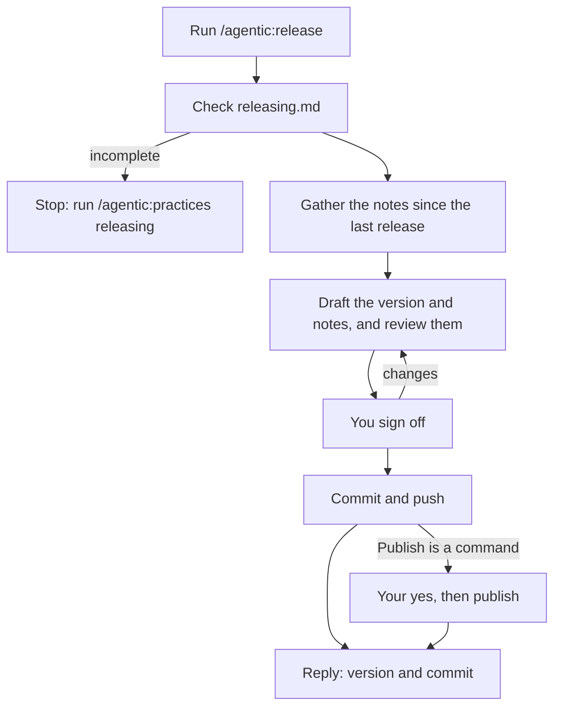

# `/release`

`/release` is the skill for making a release: one numbered version of the product, with release
notes that say what it gives the people who use it, tied to one exact commit. If your project
publishes its releases, such as a library sent to a package index or an image sent to a registry,
publishing is part of releasing too. Its usual place in [the lifecycle](../../README.md) is after
enough work has been built, checked with [`/verify`](verify.md) and merged; it never merges
anything itself. Read that page first for the documents, skills and agents it mentions.

## Releasing, publishing and deploying

These three words are easy to mix up, so the plugin uses them this way:

- **Releasing** makes a fixed, numbered version: the version number, the release notes, and the
  one commit they describe. Every project that releases does this.
- **Publishing** puts that fixed version where others can fetch it, such as PyPI, npm, a container
  registry or a release page. Only some projects publish: a library or an app people install
  does; a service deployed straight from its source code, or this plugin, does not, and for them
  the merged commit is the release. Publishing happens once per release and can't be undone: a
  package index lets you withdraw a version, not replace it.
- **Deploying** runs a release on machines you look after, in an environment such as staging or
  production, checks it works and can roll it back. That is [`/deploy`](deploy.md)'s job. A
  library is released, and perhaps published, but never deployed: whoever uses it deploys their
  own product.

## Your releasing practice

How a project releases differs too much from one project to the next for the plugin to choose,
so `/release` carries out the steps your project has recorded and decides none of them. It reads
them from `docs/practices/releasing.md`, which [`/practices`](practices.md) writes with
you:

- **What may be released** (required): which branches, and whether code must be merged first.
- **Version and its commit** (required): how versions are numbered, the files that hold the
  version, and how a release is tied to its commit, such as a tag, the commit that changed the
  version file, or an image label.
- **Publish** (required): one command, or a line starting `None:` when nothing is published by
  hand, such as "None: the merged commit is the release" or "None: the pipeline publishes it".
- **Release notes**, **When to release**, **Where it runs** and **Undoing a release** (optional).
  Where one is missing, `/release` works it out from your repository, such as an existing
  `CHANGELOG.md`, and its reply says what it assumed.

So a team chooses, in that one file, whether it releases after every merge or in batches, whether
it prepares a release on a short-lived release branch or on the branch the work was built on,
whether a person, the pipeline or nobody publishes, and whether it uses tags. The plugin fixes
only what every release needs, whatever the method:

- a person signs off the version and release notes, and says yes before anything is published;
- every release names the one commit it came from;
- `/release` says plainly when that commit is not on your repository's default branch.

Every step it runs is one command, as [the lifecycle rules](../lifecycle.md#principles) require,
and `/release` never writes or changes a command. Before it does anything, it runs the practices
skill's check, `practice_complete.py`, on `releasing.md`. If the file is missing, or a required
heading is missing, empty or still holds a default Claude proposed, it changes nothing, shows the
check's lines, and asks you to run `/agentic:practices releasing`. The same goes for a step it
needs that has no command, such as a publish step written as prose.

## How a run goes

1. **Check the practice**, as above, and that nothing is uncommitted, since the release must be
   one exact commit.
2. **Find the last release**, the way "Version and its commit" says, such as the newest tag or
   the last commit that changed the version file, and show it to you. With no earlier release,
   it starts from the first commit.
3. **Gather the notes written at build time.** Every [`/build`](build.md) hand-over commit
   carries a draft release note in its message, written from the plan and its specs while they
   were in hand, as a line starting `Release-note:` (a git trailer, the standard way to add
   labelled lines to a commit message). A script that ships with the plugin lists every commit
   between the last release and the commit being released, and collects each such line. It reads
   any line starting `Release-note:`, not only the trailers at the very end, since a squash merge
   folds a branch's messages into one body. So the notes don't depend on the plan still existing,
   on its status, or on the project keeping a changelog.
   Work done outside `/build`, such as a quick correction, has no note: for those commits Claude
   drafts one from the commits themselves, marks it as drawn from history, and you include it,
   reword it or leave it out. If a build's note is missing, as when a squash merge kept only the
   pull request's title, Claude says so.
4. **Draft the version.** It proposes the next version by the recorded scheme, such as a minor
   version when something new was built and a patch when only corrections were.
5. **Draft the release notes,** in the form and place the practice gives, such as a new entry at
   the top of `CHANGELOG.md`. They are written for the people who use the product: what they can
   now do, drawn from the gathered notes, never from the code.
6. **Review.** The release notes are reviewed like every document a skill writes (see
   [the review process](../lifecycle.md#review-process)). The `release-reviewer` agent checks
   that every gathered note, and every item drawn from history you chose to include, is
   covered; that nothing is claimed that no note says; that the notes are written for the people
   who use the product, in the recorded form; and that no plan names, file paths or code details
   appear. The shared language checker reads them beside it. Then come one correction and the
   correction check. The version number is not reviewed: it follows from the recorded scheme,
   and you sign it off with the notes.
7. **Sign-off.** You read the version and the notes, with the reviews, and sign them off or ask for
   changes. Nothing is committed before you do.
8. **Commit and push.** It writes the version into the files the practice names and commits them
   with the notes, in one commit, then pushes if there is a remote. Where it commits comes from
   the practice: on the branch the work was built on, for a project that releases with each
   merge, or else on a new branch cut from the newest commit of the branch you release from,
   named as your practices say or `release/<version>`. It never commits to your default branch,
   never opens a pull request and never merges.
9. **Publish,** only when `Publish` is a command. The commit must be one "What may be released"
   allows, such as a commit on `main` once merged, the same commit the remote has, with nothing
   uncommitted. If it isn't yet, as when the release commit still has to be merged, `/release`
   says so and stops: once you've merged, run `/agentic:release` again on that commit and it
   offers to publish the version found there.[^releaseplease] Before publishing, it shows the version, the commit
   and the exact command, and waits for your yes. Then it runs the command, filling in `{version}`,
   `{commit}` and `{notes}` (a file holding the release notes) where the command has them.
10. **Reply.** It names the version and the commit the release came from, says whether it was
    published, and says what is left for you, such as merging the release branch.

If the publish command fails, `/release` stops, shows what it printed, and never tries again on
its own, since a publish that half worked, such as a package uploaded but its tag not pushed, must
be looked at by a person. "Undoing a release", where recorded, is named in the reply as the way
back; `/release` never runs it.

## What it never does

- **Choose a method.** Batched or per merge, release branches or not, tags or not, who publishes:
  all come from your practice.
- **Write or change a command,** or run a step that has none.
- **Merge, or open a pull request.** Merging is yours, whenever and however your process says.
- **Publish without your yes,** or retry a publish that failed.
- **Deploy.** That is [`/deploy`](deploy.md), run once per environment, each time with your yes.
- **Handle secrets.** Publishing usually needs credentials, such as a package index token. The
  recorded command fetches them from wherever "Where it runs" says they live; `/release` never
  reads, prints or stores them.

[^releaseplease]: The shape, a commit that carries the version and changelog, and a publish that
    starts from the merged commit, is the one Google's
    [release-please](https://github.com/googleapis/release-please) uses.
