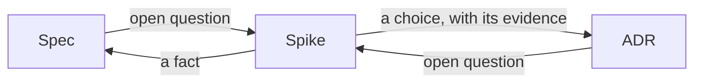
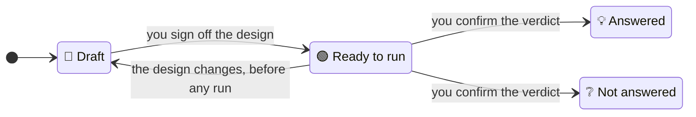

# `/spike`

`/spike` is the skill for settling an unknown by trying something. It is one step of
[the SDLC](../../README.md); read that page first for the documents, skills and agents it
mentions.

## What a spike is

Some questions can't be answered by thinking or reading. Will this library parse our files? Can
the payment provider's test system send refunds? Does this approach stay fast with a million
rows? A spike answers one such question with the smallest experiment that can answer it.[^beck]
What a spike produces is knowledge, not code: the code is never copied into the product.

The question usually comes from a document's Open questions: a spec that can't say what the
system should do until something is known, or an ADR (architecture decision record) that can't
choose between its options without measuring them. It can also come straight from you.

Each spike is written up as a **spike record**: one file holding the question, the experiment,
what it produced and the answer. The record lets a spike outlive the session that ran it, be
resumed, be handed to a teammate once you commit it, and be run again by anyone who doubts the
result.

The answer is then used by the document the question came from:



- **A fact** about the world, such as "the provider's test system can't send refunds", goes into
  the spec, through [`/spec`](spec.md). A negative result counts too: a spike that shows a
  feature is harder than it looked may change what the spec asks for.[^shore]
- **A choice** between ways of building something goes into an ADR, through [`/adr`](adr.md). The
  spike's measurements go into the ADR's Considered options, so the reason for the choice stays
  with it.

`/spike` never edits a spec or an ADR itself. Whoever looks after that document runs `/spec` or
`/adr` with the spike record as input, whenever suits them, possibly in another session.

## Where spike records live

Spike records live in one flat folder, `docs/spikes/`, each named for the date it was started and
its question:

```
docs/spikes/
  2026-10-21-tiff-files-open.md          💡 Answered
  2026-11-04-refunds-in-test-system.md   📝 Draft
```

**Nothing refers to a spike record**, so it can be deleted at any time without leaving another
document wrong or pointing at nothing. A spec or ADR that uses a spike's answer states the
evidence in its own words, such as "all 20 sample files opened", instead of pointing to the
record. A spike record may name the spec or ADR whose question it answers, as a plan names the
specs it builds: once the spike is finished the record is never changed, so it stays a true
account of how that document stood.

## The parts of a spike record

| Part | Holds |
|---|---|
| `status:` | `📝 Draft`, `🟢 Ready to run`, `💡 Answered` or `❔ Not answered` |
| Title | The question, in plain words |
| Question | The one question the spike answers, and the spec or ADR it comes from, if any |
| What would answer it | The result that settles the question, such as "all 20 sample files open" or "under 200 milliseconds for a million rows" |
| Experiment | What the experiment does and why that answers the question; how many times it runs, and any result that would end it early, such as a crash showing the approach can't work; each input, as a path in the commit it starts from or a web address; the names of any secrets it needs; the command that runs it, including any install step; and the commit it starts from, when it needs the product's own code or files |
| Answer | Yes, No, or Yes provided that a stated condition holds, comparing the runs with What would answer it; or, when the spike settled nothing, what was learned and what is still unknown |
| Surprises | Anything unexpected the experiment showed, or "None." |
| Where it goes | What should change in the spec, and in an ADR, or "Nothing" for each |
| Open questions | What only you can settle about the spike; "None." before it moves on |
| Code | At the bottom, so the record reads as prose first: the experiment's code in code blocks, each naming its file on its first line; for an experiment on the product's own code, its changes as a diff |
| Runs | Last, written only by the run script (see [The run script](#the-run-script)): for each run, when and where it ran, a short hash of the code it ran, and its output; or what you saw, for a step only a person can do |

Keeping the code in the record, rather than in files beside it, keeps the folder flat and stops
the project's own tools, such as its test runner or linter, from picking the code up. There is
no length limit: good spikes are small, often a few dozen lines,[^shore] because they answer one
question.

## Statuses



- `📝 Draft`: the question, what would answer it and the experiment are being written.
- `🟢 Ready to run`: you have signed off the reviewed design. From here the Question, What would
  answer it and Experiment are fixed. Until the first run, changing any of them returns the record
  to `📝 Draft`, for you to sign off again; after it, they can't change at all, and a different
  question is a new spike record. Fixing What would answer it before seeing any results stops a
  spike from changing, after seeing the results, the result that counts as success. The Code may
  still be corrected when the experiment itself is at fault, for example when it crashes for a
  reason other than one the Experiment names as a result. Earlier runs then stay in Runs but no
  longer count: the Answer rests only on runs of the latest code, which must reach the full number
  of runs again.
- `💡 Answered`: the runs settled the question, and you confirmed the reviewed verdict. "No" is as
  good an answer as "Yes".
- `❔ Not answered`: the experiment couldn't run or settled nothing, for example because it needs
  a system nobody can reach yet, and you confirmed that. The open question it came from stays
  open.

Both finished statuses are final: the record is never changed again, only deleted once nobody
needs it. Another try at a question that was not answered is a new spike record.

A plugin hook enforces these rules when Claude edits a record with its file-editing tools: it
refuses any move not shown above, a move forward while Open questions holds anything, a change to
the fixed parts of a `🟢 Ready to run` record that does not return it to `📝 Draft` before the first
run, any change to Runs, and any change to a finished record. A change made by hand, or by a shell command, is not checked.

## Using `/spike`

Run `/sdlc:spike` with the question, such as "can the image library read the scanner's TIFF
files?", with the document whose open question you want settled, or with a spike record to carry
on with.

1. **Design.** `/spike` sharpens the question until one experiment can answer it, and writes the
   record's Question, What would answer it, Experiment and Code with you. One spike answers one
   question: if you ask several, it says how many and takes them one at a time. Reading
   documentation helps it design the experiment, but never counts as evidence.[^shore]
2. **Review the design.** The record goes through the review sequence (see [Review](#review)).
   When you sign off the design, `/spike` sets `🟢 Ready to run`.
3. **Run.** It runs the experiment only through the run script, exactly as many times as the
   Experiment says, and stops early only on a result the Experiment named in advance.
4. **Review the verdict.** It writes the Answer, Surprises and Where it goes, and the record goes
   through the review sequence again. When you confirm the verdict, it sets `💡 Answered` or
   `❔ Not answered`, and tells you which spec or ADR to take the answer to next.

If a step needs you, for example to try something on your own device, `/spike` asks you then and
passes your answer to the run script unchanged, which records it as a run. This is the one result
that passes through Claude, so the run says it is your observation. Secrets reach the experiment as environment
variables that Claude Code already has: set before it started on your own machine, or in the
environment settings of a cloud session. They are never typed into the conversation. If a secret
can't reach the experiment, the spike ends `❔ Not answered`.

One person runs a record at a time. To hand an unfinished spike to someone else, commit the
record and tell them; `/spike` never commits for you.

## The run script

The run script is the only way `/spike` runs an experiment, so that the results in the record are
exactly what the experiment produced:

- It refuses to run unless the record is `🟢 Ready to run`.
- It writes each code block to the file it names, and copies in each input the Experiment names,
  in a working folder in the plugin's own data folder, outside your repository. Where that folder
  can't be written, as in a sandbox, it uses a folder in the system's temporary folder that only
  you can open. It runs the
  Experiment's command there with the POSIX shell. When the question is about how an approach
  works in your own code, the working folder holds a copy of the commit the Experiment names,
  with the record's diff applied, so the same copy can be made again in a later session or on a
  teammate's machine. Your working tree, and any uncommitted work, is never touched, and is not
  in the copy either.
- Every run starts from a fresh working folder, built only from the record, so nothing from an
  earlier run, and nothing outside the record, reaches it. Nothing a run changes is written back.
- It adds each run to Runs: the date, the operating system and whether it ran on your machine or
  in a cloud session, a short hash of the code it ran, and the output word for word. It replaces
  the value of each secret the Experiment names, and of any variable in Claude Code's environment
  whose name looks like a credential, with its name, and common shapes of credentials, such as
  access tokens and private keys, with a note of what kind they were; the run says how many
  values it hid. It hides them in your observations too. Variables that look like credentials
  don't reach the experiment at all unless the Experiment names them. It shortens very long
  output, saying what it left out, and stops a run, and everything the run started, still going
  9 minutes after the script began. Claude never retypes a result. Hiding values misses a secret
  that the code prints in another form, such as encoded, so the review checks that no code prints
  a secret at all.
- It deletes the working folder after each run, and any folder this project left over for a spike
  record that is finished or deleted.

Spike code is never copied into the product, even when it works. When the work is built,
[`/build`](build.md) writes it again, test first.[^shore]

## Review

A spike record is reviewed twice: once when its design is written, and once when its verdict is.
Each time, a reviewer agent checks it against a short list of pass-or-fail checks, and the checks
that apply depend on the status the record is moving to.

- **Before `🟢 Ready to run`:** it asks one question; What would answer it is concrete enough to
  pass or fail; the experiment, run as described, would show whether it does; it runs enough
  times for results that can vary, such as anything over a network or anything that calls an AI
  model; every input it needs is named; and no code prints a secret.
- **Before `💡 Answered` or `❔ Not answered`:** every run is in Runs, and the runs of the latest
  code reach the number the Experiment names, or stop early on a result it names; the Answer follows from the runs measured against What would answer it,
  not from documentation; and Where it goes sends facts to the spec and choices to an ADR, as
  the reviewer finds them in `docs/specs/` and `docs/adrs/`.

The reviewer sees the record and those folders, not your conversation, so it judges the spike as
a newcomer would. At the same time, a language checker reads it for words a newcomer could not
follow, by the [Plain words](../lifecycle.md#plain-words) rule. Each time, `/spike` corrects what
both find, once, and has the corrections checked (see
[Review process](../lifecycle.md#review-process)).

## What we chose not to do

- **No "how to do it" spikes kept as documentation.** Some teams keep spikes that show how to do
  a task, as examples.[^shore] Here a spike record can be deleted at any time, so nothing may
  depend on it; a lasting way of doing things belongs in an ADR or in the project's practices.
- **No experiments in your working tree.** Working in the real code, after committing everything
  first, is a common way to try a design.[^shore] A copy outside the repository gives the same
  answer without any risk to your work.

[^beck]: Kent Beck's spike solution in Extreme Programming, described on the
    [C2 wiki](https://c2.com/xp/SpikeSolution.html): build only what the question needs, and
    expect to throw it away.
[^shore]: James Shore, *The Art of Agile Development*,
    [Spike Solutions](https://www.jamesshore.com/v2/books/aoad1/spike_solutions).
