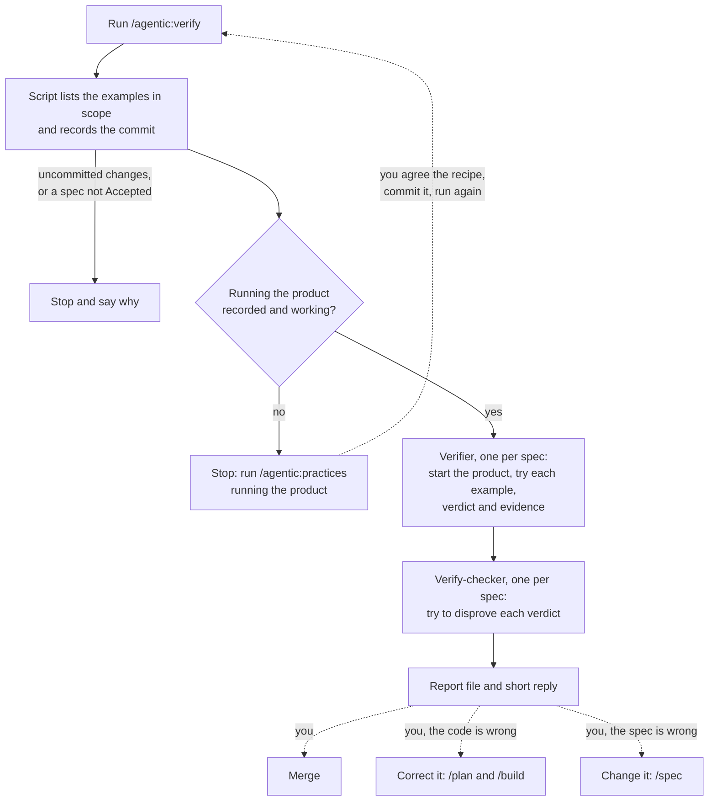
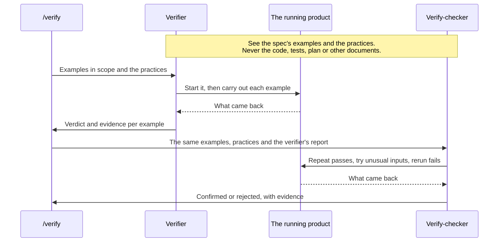

# `/verify`

`/verify` is the skill for checking what was just built, from the outside: it starts the product,
uses it the way a person would, and says for each example in the accepted specs whether the
product does what the example says. It comes after [`/build`](build.md) and before you merge, in
[the lifecycle](../../README.md), though you can run it at any time. Read that page first for the
documents, skills and agents it mentions.

## Why it exists

A `✅ Built` plan says the code was written, tested and reviewed. It does not say the product works.
`/build`'s reviewers read the code and its tests, and a reviewer that reads the code tends to judge
it as the code means it, not as it behaves. [`/audit`](audit.md) is the same: it reads the code and
runs nothing. Neither stands the product up and tries it.

`/verify` does, and it never reads the code. Its agents see only the accepted specs and how to run
the product, so the only way they can judge is by what the product does. This is verification in
its usual sense: does the product match its specs?[^boehm] Whether the specs ask for the right
thing is a different question, and stays with you.

It is a sanity check for whoever just built the work, not a lasting test suite. Its agents write
throwaway tools to drive the product and leave them behind; nothing they write joins your tests.
Tests that keep the product working stay `/build`'s job.

## Running the product

`/verify` can only check a product it knows how to start and use, so it relies on one recorded
practice, **Running the product**: a topic of [`/practices`](practices.md), in
`docs/practices/running.md` with a line for it in the core. It says:

- what machine and services the product needs, and the commands that start and stop it;
- how to reach each of its interfaces, such as a web address, a command, or a tool to call;
- how to put it in the state an example starts from, such as adding test data;
- what is safe to touch, and what must never be touched, such as real customer data, a live
  payment service or a shared database.

**The first time, `/verify` stops.** When the topic is not recorded, `/verify` checks nothing. It
says the practice is missing and asks you to run `/agentic:practices running the product`. That
run works like any other topic: `/practices` reads the repository and proposes how to start the
product and what is safe to touch, one question at a time. This topic has one more step: before
recording it, `/practices` tries it, starting the product with the proposed commands and reaching
each interface once. When something fails, it proposes a change and tries again, until the product
runs and you agree the recipe is right. Only then does it write the topic, under its usual review.
Run `/verify` again once you have committed it.

`/verify` itself never writes a practice. If a later run finds the recipe no longer works, such as
a start command that fails, it stops the same way and names what failed, so you can correct the
topic with `/practices`.

If your project already has a run skill made by Claude Code's `/run-skill-generator`, the practice
can simply name it.[^run]

## What it checks

`/verify` checks examples: the Given, When and Then rows under each requirement of a spec. Each
example gets one verdict:

- **pass**: the product did what the example's Then says;
- **fail**: it did something else;
- **not checked**, with the reason: the example could not be tried, such as one that needs a real
  clock to reach midnight, a service the practice marks as never to be touched, or a person to
  watch.

A failure of the agent's own tools or setup, such as a script that crashes, is **not checked**,
never **fail**. Nothing is skipped without a reason.

Every verdict carries its **evidence**: what was done to the product and what came back, such as
the command run and its output, or the request sent and the response. You can judge every verdict
yourself without trusting the agent.

The examples are judged against the specs as they stand now, which must be `👍 Accepted`. A plan
only says which requirements to check; its text is never read, since it is about the code.

## How much a run checks

- `/agentic:verify` checks the requirements of the plan that this branch marked `✅ Built`. If the
  branch built more than one plan, or none, it asks which plan, spec or scope you mean.
- `/agentic:verify <plan>` checks the requirements that plan names.
- `/agentic:verify <spec>` checks every requirement of one accepted spec.
- `/agentic:verify all` checks every accepted spec.

A run takes real time: in a trial, checking 7 requirements of a mail service took about 45 minutes
of agent time. That is why the usual scope is the requirements one build delivered.

`/verify` stops and says why, without checking anything, when:

- the branch has changes that are not committed, since its report names the commit it checked;
- the plan or spec you named doesn't exist, or a spec in scope isn't `👍 Accepted`;
- Running the product is not recorded, or no longer works;
- the practice says the product needs a machine this session is not running on, such as a Mac.

## How a run goes

1. **Scope.** A script that ships with the plugin lists the requirements and examples in scope,
   records the commit, and refuses uncommitted changes. No AI is involved.
2. **The verifier.** One fresh agent per spec, starting without your conversation. It is given that
   spec's examples in scope and the practices, and nothing else: not the code, the tests, the plan
   or any other document. It starts the product as the practice says, turns each example into
   steps, carries them out against the product's real interfaces, and records a verdict and its
   evidence. It may write throwaway tools to do so, in a temporary folder outside your repository.
   Specs are checked one after another, since each verifier starts and stops the product.
3. **The verify-checker.** For each spec, one more fresh agent, with the same limits, tries to
   disprove the verifier's verdicts, as Claude Code's own `/code-review` checks what its
   problem-finding agents report.[^codereview] It repeats each pass and tries the edges of its
   example; it reruns each fail once, to rule out a one-off; and it tries again any example left
   not checked. It says of each verdict whether it is **confirmed** or **rejected**, with its own
   evidence.
4. **The report.** A verdict the verify-checker confirmed stands. A rejected one is shown with
   both agents' evidence, as disputed, for you to decide.

What each part sees, and what it never sees:

In a trial run, the verify-checker confirmed both real failures, closed a gap in one pass by also
trying interrupted runs, and flagged a pass that held only because of timing.

## What it never does

- **Read the code.** Its agents are told never to read the code, tests, plans or other documents.
  An agent that can run commands could read them anyway, so this rests on its instructions; its
  evidence lists every command it ran, so a read would show.
- **Touch what the practice forbids.** An example that could only be tried that way is not checked.
- **Change your repository.** It writes no file, sets no status and makes no commit. If starting
  the product changes a tracked file, such as a lock file, the report says so.
- **Run inside a build.** `/build` never starts the product, so it can run unattended on any
  machine. `/verify` runs separately, where the product can run.

## What you get

The overall result comes first: every example passed, some failed or are disputed, or some could
not be checked. Then, for each spec, the failures, the disputed verdicts, the examples not checked
and why, and last the passes, each with its evidence. Each failure names its suggested next step:

- **Correct the code**, when the spec is right: through [`/plan`](plan.md) and `/build`, or
  directly for a small correction;
- **Return the spec to `📝 Draft`** and change it, through [`/spec`](spec.md), when the product is
  right and the spec is not.

Each example not checked says what would make it checkable, such as a way to set the product's
clock, which may be worth a requirement of its own.

As with `/build` and `/audit`, the full report goes in a Markdown file and Claude's reply is short,
under 150 words: the outcome, at most five bullets of at most 15 words each, then the file's full
path. The file holds the commit checked and every agent's report copied in word for word by the
plugin's script. It is kept in the plugin's own data folder, outside your repository, at
`reports/<repository>/<date>-verify-<scope>.md`, until you delete it.

You then decide what to do: merge, correct the code through a new plan, or change the spec.

[^boehm]: Barry Boehm, *Software Engineering Economics* (1981), separates verification, "are we
    building the product right?", from validation, "are we building the right product?".
[^run]: Claude Code documentation, [Run and verify your app](https://code.claude.com/docs/en/skills#run-and-verify-your-app).
[^codereview]: Claude Code documentation, [Review locally with /code-review](https://code.claude.com/docs/en/code-review-local).
