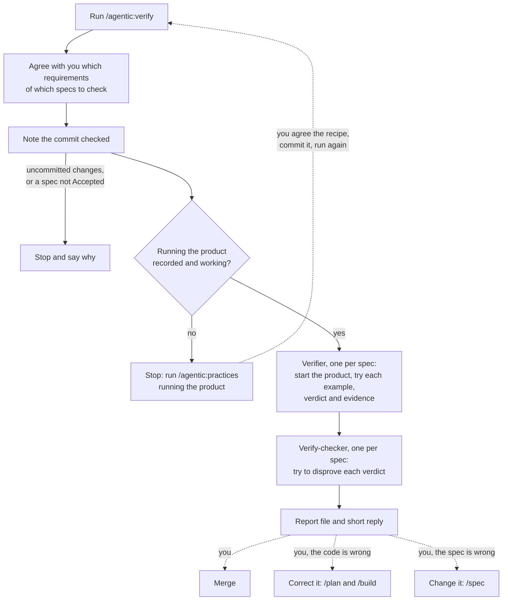

# `/verify`

`/verify` is the skill for checking the product against its specs from the outside: it starts the
product, uses it the way a person would, and says for each example in the specs whether the product
does what the example says. It begins by agreeing with you what to check: requirements of one or more
accepted specs, whenever they were built. Its usual place
in [the lifecycle](../lifecycle.md) is after [`/build`](build.md) and before you merge, but you can
run it at any time. Read that page first for the documents, skills and agents it mentions.

## Why it exists

A `Built ✅` plan says the code was written, tested and reviewed. It does not say the product works.
`/build`'s reviewers read the code and its tests, and a reviewer that reads the code tends to judge
it as the code means it, not as it behaves. [`/audit`](audit.md) is the same: it reads the code and
runs nothing. Neither stands the product up and tries it.

`/verify` does, and it never reads the code. Its agents see only the accepted specs and how to run
the product, so the only way they can judge is by what the product does. This is verification in
its usual sense: does the product match its specs?[^boehm] Whether the specs ask for the right
thing is a different question, and stays with you.

It is a sanity check, not a lasting test suite. Its agents write
throwaway tools to drive the product and leave them behind; nothing they write joins your tests.
Tests that keep the product working stay `/build`'s job.

## Before it starts: Running the product

`/verify` needs to know how to start the product and what is safe to touch, so it relies on the
[Running the product](practices.md#running-the-product) practice. If that practice is not recorded,
or no longer works, `/verify` checks nothing: it says so and asks you to record or correct it with
`/agentic:practices running the product`, then run `/verify` again.

Both agents start and stop the product many times, so ready-made helpers in that practice save
them time, such as a command that resets the product to a known state or one that makes a
connection fail at once instead of after a long wait.

## What it checks

`/verify` checks examples: the Given, When and Then rows under each requirement of a spec. Each
example gets one verdict:

- **pass**: the product did what the example's Then says;
- **fail**: it did something else;
- **not checked**, with the reason: the example could not be tried, such as one that needs a real
  clock to reach midnight, a service the practice marks as never to be touched, or a person to
  watch.

A failure of the agent's own tools or setup, such as a script that crashes, is **not checked**,
never **fail**. Nothing is skipped without a reason.

Every verdict carries its **evidence**: what was done to the product and what came back, such as
the command run and its output, or the request sent and the response. You can judge every verdict
yourself without trusting the agent.

The examples are judged against the specs as they stand now, which must be `Accepted 👍`. A plan
only says which requirements to check; its text is never read, since it is about the code.

## Choosing what to check

Every run starts by agreeing with you what it will check: a list of requirements, each from an
accepted spec. Say it however is natural, after the command or when asked:

- a requirement, or several, such as "requirements 2 and 7 of the mail pull spec";
- a whole spec, or several;
- every accepted spec;
- a plan, which stands for the requirements it names, such as the one a build just delivered.

Run on its own, `/agentic:verify` proposes a list from what it can see, such as the requirements of
the plan this branch marked `Built ✅`, and asks you to confirm or change it. Whatever you named,
it shows the list it will check, each spec with its requirements and how many examples they hold,
and checks nothing until you agree. A requirement whose spec is not `Accepted 👍` is left out, and
the list says why.

`/verify` stops and says why, without checking anything, when:

- the branch has changes that are not committed, since its report names the commit it checked;
- the practice says the product needs a machine this session is not running on, such as a Mac.

## How a run goes

1. **What to check.** Claude agrees the list of requirements with you, as above, notes the commit
   being checked, for the report, and refuses to start while there are uncommitted changes, since
   the report could then not say which version of the product was checked.
2. **The verifier.** One fresh agent per spec (`agents/verifier.md`), starting without your conversation. It is given the
   path to that spec, the requirements to check in it, and the practices, and nothing else: not the code, the tests, the plan
   or any other document. It starts the product as the practice says, turns each example into
   steps, carries them out against the product's real interfaces, and records a verdict and its
   evidence. It may write throwaway tools to do so, in a temporary folder outside your repository.
   Specs are checked one after another, since each verifier starts and stops the product.
3. **The verify-checker.** For each spec, one more fresh agent (`agents/verify-checker.md`), with the same limits, tries to
   disprove the verifier's verdicts, as Claude Code's own `/code-review` checks what its
   problem-finding agents report.[^codereview] It repeats each pass and tries the edges of its
   example; it reruns each fail once, to rule out a one-off; and it tries again any example left
   not checked. It says of each verdict whether it is **confirmed** or **rejected**, with its own
   evidence. Since it challenges every verdict, passes included, it is a second full run and
   takes about as long as the verifier, so checking only the requirements a change touches keeps
   `/verify` short.
4. **The report.** Claude writes the full report as a Markdown file in the session's scratchpad,
   outside your repository, and replies with a short summary of at most five bullets and the
   file's path, as `/build` and `/audit` do (see [What you get](#what-you-get)). In it, a verdict
   the verify-checker confirmed stands; one it rejected is shown with both agents' evidence, as
   disputed, for you to decide.

What each part sees, and what it never sees:

## What it never does

- **Read the code.** Its agents are told never to read the code, tests, plans or other documents.
  An agent that can run commands could read them anyway, so this rests on its instructions; its
  evidence lists every command it ran, so a read would show.
- **Check ADRs.** An ADR decides how the product is built, which mostly shows only in the code.
  [`/build`](build.md)'s reviewer and [`/audit`](audit.md) check ADRs against the code, and
  `/audit` lists any ADR check that needs something run.
- **Touch what the practice forbids.** An example that could only be tried that way is not checked.
- **Change your repository.** It writes no file, sets no status and makes no commit. If starting
  the product changes a tracked file, such as a lock file, the report says so.
- **Run inside a build.** `/build` never starts the product, so it can run unattended on any
  machine. `/verify` runs separately, where the product can run.

## What you get

The overall result comes first: every example passed, some failed or are disputed, or some could
not be checked. Then, for each spec, the failures, the disputed verdicts, the examples not checked
and why, and last the passes, each with its evidence. Each failure names its suggested next step:

- **Correct the code**, when the spec is right: through [`/plan`](plan.md) and `/build`, or
  directly for a small correction;
- **Return the spec to `Draft 📝`** and change it, through [`/spec`](spec.md), when the product is
  right and the spec is not.

Each example not checked says what would make it checkable, such as a way to set the product's
clock, which may be worth a requirement of its own.

As with `/build` and `/audit`, the full report goes in a Markdown file and Claude's reply is short,
under 175 words: the outcome, at most five bullets of at most 15 words each, then the file's full
path. The file holds the commit checked and every agent's report copied in word for word by the
plugin's script. It is kept in the session's scratchpad, a temporary folder Claude Code gives each session, outside
your repository, at `agentic/reports/<repository>/<date>-verify-<what was checked>.md`, until
Claude Code clears it.

You then decide what to do: merge, correct the code through a new plan, or change the spec.

[^boehm]: Barry Boehm, *Software Engineering Economics* (1981), separates verification, "are we
    building the product right?", from validation, "are we building the right product?".
[^codereview]: Claude Code documentation, [Review locally with /code-review](https://code.claude.com/docs/en/code-review-local).
